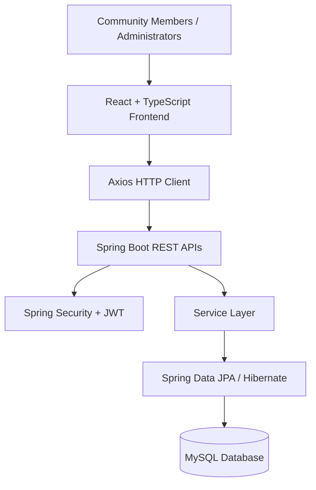

# ReCircle — Community Sharing & Resource Exchange

<p align="center">
  <strong>Share More. Waste Less. Build Trust.</strong>
</p>

<p align="center">
  A community-driven platform for borrowing, lending, renting, exchanging, and donating resources.
</p>

<p align="center">
  
  
  
  
  
  
</p>

---

## Overview

ReCircle is a general community-sharing and resource-exchange management platform designed to encourage sustainable consumption and strengthen community relationships.

People often own products that remain unused for long periods, while others may need those same resources temporarily. ReCircle bridges this gap by providing a centralized platform where community members can share resources instead of purchasing everything independently.

Users can list items, borrow resources, lend belongings, exchange products, rent equipment, and donate items to other members.

The platform introduces a dynamic **Community Trust Score** that helps users evaluate the reliability of other members through completed transactions, peer reviews, account verification, and responsible return behavior.

## Problem Statement

Many individuals own resources that are rarely used, while others may need those resources for short-term purposes. However, the absence of a centralized and trustworthy sharing platform creates several challenges:

- Underutilization of existing resources.
- Unnecessary purchases and increased consumption.
- Difficulty finding people willing to lend or exchange items.
- Lack of transparency in borrowing and rental arrangements.
- Limited accountability between users.
- Difficulty identifying trustworthy community members.

ReCircle addresses these challenges through structured sharing workflows, user reviews, verification, dispute management, and reputation tracking.

## Project Objectives

- Create a centralized platform for community resource sharing.
- Enable borrowing, lending, renting, exchanging, and donating.
- Provide secure user registration and authentication.
- Simplify resource discovery through categories and location-based filters.
- Maintain transparent transaction and return workflows.
- Encourage responsible sharing through reviews and ratings.
- Introduce a dynamic trust score to promote accountability.
- Support dispute reporting and administrative resolution.
- Encourage sustainable consumption and reduce resource wastage.

---

## Key Features

### 1. User Registration and Authentication

- Registration using general email addresses.
- Email OTP verification.
- Secure password hashing using BCrypt.
- JWT-based authentication.
- Access and refresh token management.
- Login, registration, and password recovery.
- Optional student or institutional information.

### 2. Resource Listing and Discovery

- Create, update, view, and manage resource listings.
- Upload item images.
- Organize resources by category.
- Specify item condition and availability.
- Select sharing modes.
- Discover resources using location and category filters.
- View item descriptions, owner information, and availability.

### 3. Borrowing and Lending

- Submit borrowing requests.
- Manage incoming lending requests.
- Approve or reject requests.
- Select borrowing periods.
- Track handover and return status.
- Maintain borrowing history.

### 4. Item Exchange Management

- Propose item-for-item exchanges.
- Select an item to offer in exchange.
- Accept or reject exchange proposals.
- Manage exchange handovers.
- Require confirmation from both participants.
- Track completed exchanges.

### 5. Rental Management

- Create rental listings.
- Submit rental requests.
- Calculate rental duration and charges.
- Track rental handovers and returns.
- Manage deposits and payment statuses.
- Monitor on-time returns.

### 6. Community Donations

- List resources for free donation.
- Add donation descriptions and motivation notes.
- Allow interested members to request donated items.
- Manage donation allocation.
- Prevent multiple recipients from claiming the same donation.

### 7. Reviews and Ratings

- Submit reviews after completed transactions.
- Provide ratings from 1 to 5 stars.
- Add written feedback.
- View community member reviews.
- Prevent duplicate reviews for the same transaction.

### 8. Dispute Management

- Report transaction-related disputes.
- Submit supporting evidence.
- Track dispute status.
- Allow moderators and administrators to investigate reports.
- Resolve disputes and apply reputation penalties where appropriate.

### 9. Admin Dashboard

- View platform statistics.
- Manage community members.
- Monitor resource listings.
- Review transactions.
- Manage disputes.
- Monitor platform activity.
- Maintain administrative audit records.

---

## Community Trust Score

One of ReCircle's main differentiators is its dynamic **Community Trust Score**.

The trust score helps users understand the reliability of other community members before participating in a transaction.

It is calculated using four weighted components:

| Component | Weight |
|---|---:|
| Verified Account Status | 15% |
| Completed Transactions | 35% |
| Peer Reviews and Ratings | 30% |
| On-Time Returns | 20% |
| **Total** | **100%** |

### Trust Score Formula

```text
Trust Score =
    (Verified Account Score × 0.15)
  + (Completed Transaction Score × 0.35)
  + (Peer Review Score × 0.30)
  + (On-Time Return Score × 0.20)
  - Dispute Penalties
```

### Component Calculation

**Verified Account Status — 15%**

Rewards users who successfully verify their account through the platform's verification process.

**Completed Transactions — 35%**

Measures completed sharing activities using an asymptotic scaling function:

```text
Completed Score = 100 × (1 - e^(-0.16 × N))
```

Where `N` represents the effective completed transaction count.

**Peer Reviews and Ratings — 30%**

Uses the average of eligible community reviews, normalized to a 100-point scale:

```text
Review Score = (Average Rating / 5) × 100
```

**On-Time Returns — 20%**

Measures how consistently users return borrowed or rented resources within the agreed timeframe:

```text
On-Time Score =
    (On-Time Returns / Eligible Returns) × 100
```

**Dispute Penalties**

Confirmed violations may result in deductions from the overall trust score depending on the dispute resolution outcome.

The score is bounded between 0 and 100, and its history is maintained for accountability and tracking.

---

## Application Modules

| Module | Description |
|---|---|
| Authentication | Registration, login, email verification and password recovery |
| Community Dashboard | Personalized user overview |
| Explore Marketplace | Discover available resources |
| Resource Management | Create and manage listings |
| Borrow and Lend | Manage borrowing requests and returns |
| Exchanges | Manage item-for-item exchanges |
| Rentals | Manage rental requests and payments |
| Donations | Manage free resource donations |
| Transactions | Track sharing activity |
| Trust and Reviews | View ratings and reputation |
| Notifications | Receive platform updates |
| Disputes | Report and resolve transaction issues |
| Admin Management | Monitor and govern platform activity |
| User Profiles | Manage personal information and preferences |

---

## Technology Stack

### Frontend

| Technology | Purpose |
|---|---|
| React 19 | Component-based user interface |
| TypeScript | Type safety |
| Vite | Development server and build tool |
| Tailwind CSS 4 | Responsive styling |
| Lucide | Interface icons |
| Recharts | Data visualization |
| Axios | HTTP requests |
| React Router | Client-side navigation |

### Backend

| Technology | Purpose |
|---|---|
| Java 21 | Backend programming language |
| Spring Boot 3.2 | Backend application framework |
| Spring Web | REST API development |
| Spring Security | Authentication and authorization |
| Spring Data JPA | Database access |
| Hibernate | ORM |
| Bean Validation | Request validation |
| JWT | Token-based authentication |
| BCrypt | Password hashing |
| Maven | Dependency and build management |

### Database

| Technology | Purpose |
|---|---|
| MySQL 9.5 | Relational database |
| InnoDB | Transaction and referential integrity |
| Hibernate ORM | Entity persistence |

---

## System Architecture

ReCircle follows a three-tier architecture.



### Architecture Layers

**Presentation Layer**

Built using React, TypeScript, Tailwind CSS, and Vite. Handles user interactions, navigation, forms, dashboards, and resource discovery.

**Application Layer**

Built using Spring Boot. Implements authentication, authorization, resource management, transaction workflows, reviews, trust score calculations, and dispute resolution.

**Data Layer**

Uses MySQL with Spring Data JPA and Hibernate to persist user information, listings, transactions, reviews, and platform records.

---

## Project Structure

```text
Recircle/
│
├── backend/
│   ├── src/
│   │   ├── main/
│   │   │   ├── java/com/recircle/
│   │   │   │   ├── config/
│   │   │   │   ├── controller/
│   │   │   │   ├── dto/
│   │   │   │   ├── entity/
│   │   │   │   ├── enums/
│   │   │   │   ├── exception/
│   │   │   │   ├── repository/
│   │   │   │   ├── security/
│   │   │   │   ├── service/
│   │   │   │   └── validation/
│   │   │   └── resources/
│   │   └── test/
│   ├── pom.xml
│   └── mvnw
│
├── frontend/
│   ├── public/
│   ├── src/
│   │   ├── components/
│   │   ├── context/
│   │   ├── hooks/
│   │   ├── pages/
│   │   ├── services/
│   │   ├── types/
│   │   ├── App.tsx
│   │   └── main.tsx
│   ├── package.json
│   └── vite.config.ts
│
├── database/
│   ├── schema.sql
│   └── seed.sql
│
├── documentation/
├── report/
├── screenshots/
└── README.md
```

---

## Database Design

ReCircle uses MySQL as its relational database.

The database manages:

- User accounts and profiles.
- Resource listings and categories.
- Borrowing and lending requests.
- Exchange proposals and handovers.
- Rental records and payment statuses.
- Donation requests.
- Reviews and ratings.
- Trust scores and trust score history.
- Notifications.
- Disputes and supporting records.
- Administrative audit logs.

Database relationships are maintained through primary keys, foreign keys, constraints, and transactional service operations.

The schema is designed to preserve transaction consistency and prevent conflicting resource reservations.

---

## Getting Started

### Prerequisites

Install the following:

- Java Development Kit (JDK) 21.
- Node.js and npm.
- MySQL Server.
- Git.
- An IDE such as IntelliJ IDEA or VS Code.

### 1. Clone the Repository

```bash
git clone https://github.com/Moonnn15/Recircle.git
cd Recircle
```

### 2. Configure MySQL

Start your MySQL server and create the database:

```sql
CREATE DATABASE recircle;
```

Configure the database connection using environment variables.

If the project uses automatic schema initialization or versioned migrations, follow the existing backend configuration. Do not execute the schema script blindly over an existing database.

### 3. Configure the Backend

Navigate to the backend directory:

```bash
cd backend
```

Configure the required environment variables.

**Windows:**

```powershell
.\mvnw.cmd spring-boot:run
```

**Linux / macOS:**

```bash
./mvnw spring-boot:run
```

The backend normally runs at:

```text
http://localhost:8080
```

### 4. Configure the Frontend

Open another terminal:

```bash
cd frontend
npm install
npm run dev
```

The Vite development server normally runs at:

```text
http://localhost:5173
```

Open the displayed local URL in your browser.

---

## Environment Configuration

Create local environment configuration using the variable names expected by the application.

Typical backend configuration:

```env
DB_URL=jdbc:mysql://localhost:3306/recircle
DB_USERNAME=your_mysql_username
DB_PASSWORD=your_mysql_password

JWT_SECRET=your_secure_secret
```

Additional settings may be required for email OTP delivery, file storage, and other integrations depending on the application configuration.

For the frontend, configure the API base URL using the variable name expected by the Vite application, for example:

```env
VITE_API_BASE_URL=http://localhost:8080
```

**Security Note:** Never commit real passwords, JWT secrets, email credentials, private API keys, or production environment files to GitHub. Keep local secrets in ignored environment files.

---

## Testing

ReCircle includes automated backend tests covering core application functionality.

### Backend Tests

**Windows:**

```powershell
.\mvnw.cmd test
```

**Linux / macOS:**

```bash
./mvnw test
```

### Frontend Production Build

```bash
npm run build
```

### Areas Covered by Testing

- Authentication and registration.
- Public email registration.
- Email verification.
- Resource creation and updates.
- Location-based discovery.
- Borrowing and lending workflows.
- Exchange management and concurrency.
- Rental calculations and returns.
- Donation allocation.
- Reviews and ratings.
- Trust score calculations.
- Dispute management.
- Audit logging.

---

## Security

ReCircle incorporates several security mechanisms:

- BCrypt password hashing.
- JWT-based authentication.
- Spring Security authorization.
- Input validation.
- Email verification.
- Role-based access control.
- Transactional database operations.
- Protection against duplicate requests and conflicting reservations.
- Administrative dispute management and audit history.

Never publish production credentials or use demonstration credentials on a public deployment.

---

## Future Enhancements

Potential future improvements include:

- Real-time messaging between community members.
- Interactive maps and location discovery.
- Push notifications.
- Integration with trusted payment gateways.
- Advanced recommendation systems.
- AI-assisted resource categorization.
- Mobile application support.
- Community impact analytics.
- Enhanced fraud detection and reputation analysis.
- Multilingual support.

---

## Contributing

Contributions and suggestions are welcome.

1. Fork the repository.
2. Create a feature branch.
3. Implement your changes.
4. Test the functionality.
5. Submit a pull request describing your changes.

Please avoid committing credentials, personal data, or production configuration files.

---

## Author

**Monalisa Bhattacharjee**

B.Tech — Computer Science and Engineering  
SRM Institute of Science and Technology

GitHub: [@Moonnn15](https://github.com/Moonnn15)

**Project Repository:**  
[https://github.com/Moonnn15/Recircle](https://github.com/Moonnn15/Recircle)

---

<p align="center">
  <strong>ReCircle — Share More. Waste Less. Build Trust.</strong>
  <br>
  Building a community where resources are shared, not wasted.
</p>
