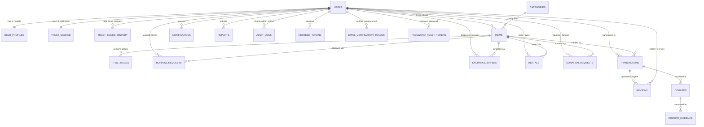

# ReCircle – Relational Database Design & Architecture (`recircle_db`)

## 1. Overview
`recircle_db` is a normalized relational database engineered for **MySQL 8.0+ / MySQL 9.5** (InnoDB storage engine, `utf8mb4_unicode_ci` collation). It enforces strict referential integrity, role-based security boundaries, concurrency control for booking conflict prevention, and immutable historical records for transactions, trust scores, and administrative audits.

---

## 2. Entity-Relationship (ER) Diagram



---

## 3. Complete Table Inventory (21 Normalized Tables)

| # | Table Name | Primary Key | Foreign Keys | Purpose |
|---|---|---|---|---|
| 1 | `users` | `id` | — | Core identity, BCrypt password hash, registration number, role (`STUDENT`, `MODERATOR`, `ADMIN`), verification flags. |
| 2 | `user_profiles` | `id` | `user_id -> users(id)` | Academic metadata (department, year of study, hostel block, bio, pickup spot, profile completion %). |
| 3 | `categories` | `id` | — | The 10 official campus resource categories with slug and icon metadata. |
| 4 | `items` | `id` | `owner_id -> users(id)`, `category_id -> categories(id)` | Resource listings with condition, sharing type, deposit, daily rental rate, availability window, and `@Version` optimistic lock. |
| 5 | `item_images` | `id` | `item_id -> items(id)` | Ordered gallery photographs per item listing. |
| 6 | `borrow_requests` | `id` | `item_id`, `borrower_id`, `lender_id` | Borrowing workflow state machine (`PENDING` -> `APPROVED` -> `ACTIVE` -> `RETURN_REQUESTED` -> `COMPLETED`). |
| 7 | `exchange_offers` | `id` | `requested_item_id`, `offered_item_id`, `proposer_id`, `receiver_id` | Peer-to-peer item bartering with dual handover confirmation flags. |
| 8 | `rentals` | `id` | `item_id`, `renter_id`, `owner_id` | Paid campus rentals with server-calculated `total_rental_amount` and simulated payment status. |
| 9 | `donation_requests` | `id` | `item_id`, `requester_id`, `donor_id` | Zero-cost student donations and recipient approval workflow. |
| 10 | `transactions` | `id` | `primary_item_id`, `initiator_user_id`, `counterparty_user_id` | Unified immutable ledger assigning a unique `transaction_code` (e.g., `RC-TX-2026-0001`) to every resource interaction. |
| 11 | `reviews` | `id` | `transaction_id`, `item_id`, `reviewer_id`, `reviewee_id` | Post-completion 1–5 star ratings with composite unique constraint `(transaction_id, reviewer_id)`. |
| 12 | `trust_scores` | `id` | `user_id -> users(id)` | Current normalized trust score (`0.00–100.00`), trust level badge, and 4 weighted component scores. |
| 13 | `trust_score_history` | `id` | `user_id -> users(id)` | Time-series audit log of every trust score recalculation event (`previous_score`, `new_score`, `delta`, `trigger_event`). |
| 14 | `notifications` | `id` | `user_id -> users(id)` | Database-backed in-app alerts with unread counter and deep links. |
| 15 | `disputes` | `id` | `transaction_id`, `reporter_id`, `reported_user_id` | Formal dispute resolution lifecycle (`OPEN`, `UNDER_REVIEW`, `RESOLVED`, `REJECTED`, `ESCALATED`). |
| 16 | `dispute_evidence` | `id` | `dispute_id`, `submitted_by_id` | Investigation comments and evidence attachments for disputes. |
| 17 | `reports` | `id` | `reporter_id -> users(id)` | Content moderation reports for inappropriate listings, users, or reviews. |
| 18 | `audit_logs` | `id` | `actor_user_id -> users(id)` | Immutable administrative and moderator action audit trail. |
| 19 | `refresh_tokens` | `id` | `user_id -> users(id)` | Revocable JWT refresh token sessions. |
| 20 | `email_verification_tokens` | `id` | `user_id -> users(id)` | Campus email OTP and verification link tokens. |
| 21 | `password_reset_tokens` | `id` | `user_id -> users(id)` | Expiring single-use password reset tokens. |

---

## 4. Normalization Analysis (1NF, 2NF, 3NF, BCNF)

1. **First Normal Form (1NF)**:
   - Every table has a surrogate primary key (`id BIGINT AUTO_INCREMENT`) and atomic attributes. Multi-valued item photographs are extracted into `item_images` rather than stored as comma-separated URLs.
2. **Second Normal Form (2NF)**:
   - All non-key attributes are fully functionally dependent on the entire primary key. In associative entities such as `reviews`, the composite candidate key `(transaction_id, reviewer_id)` uniquely determines `rating` and `comment`, while transaction metadata resides in `transactions`.
3. **Third Normal Form (3NF) & Boyce-Codd Normal Form (BCNF)**:
   - Transitive dependencies are eliminated:
     - User academic profile attributes (`department`, `year_of_study`, `hostel_or_block`) are separated into `user_profiles`.
     - Category metadata (`name`, `slug`, `description`, `icon_name`) is separated into `categories` and referenced via `category_id`.
     - Dynamic trust score metrics are separated into `trust_scores` with historical deltas isolated in `trust_score_history`.

---

## 5. Indexing & Concurrency Strategy

- **Discovery Composite Index (`idx_items_discovery`)**: Covers `(archived, availability_status, sharing_type, category_id)` to accelerate marketplace filtering queries without full table scans.
- **Date Overlap Prevention Indexes (`idx_borrow_item_dates`, `idx_rentals_item_dates`)**: Covers `(item_id, status, start_date, end_date)` so range overlap queries:
  ```sql
  SELECT COUNT(*) FROM borrow_requests
  WHERE item_id = :itemId
    AND status IN ('APPROVED', 'ACTIVE', 'RETURN_REQUESTED')
    AND start_date <= :requestedEndDate
    AND end_date >= :requestedStartDate
  ```
  execute as fast index range scans inside `@Transactional` service boundaries.
- **Optimistic & Pessimistic Concurrency Control**: The `items` entity includes a `@Version` column (`version BIGINT`) alongside transactional reservation validation so simultaneous approval attempts cannot double-book the same resource.
