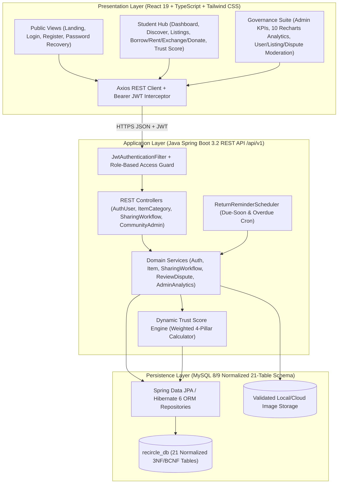

# ReCircle — System Architecture & Security Engineering

## 1. High-Level Three-Tier Architecture
ReCircle follows a modular, layered **Three-Tier Full Stack Architecture** separating presentation, domain business logic, and persistent storage:

---

## 2. Backend Package Structure
- `com.recircle.controller`: Exposes RESTful JSON endpoints grouped by bounded context (`AuthUserController`, `ItemCategoryController`, `SharingWorkflowController`, `CommunityAdminController`).
- `com.recircle.service`: Transaction-demarcated (`@Transactional`) domain services enforcing business invariants (conflict-free reservations, single-recipient donations, backend-computed rental pricing, and duplicate-review prevention).
- `com.recircle.security`:
  - `PasswordHasher`: Salted **BCrypt** (`strength = 12`) hashing with constant-time verification.
  - `JwtService`: Stateless **HMAC-SHA256** (`HS256`) token generation and signature verification.
  - `JwtAuthenticationFilter`: Servlet filter extracting `Authorization: Bearer <token>` and populating `AuthContext`.
- `com.recircle.scheduler`: `ReturnReminderScheduler` runs periodically to inspect active borrow/rental transactions, emit due-date reminders, and transition past-due handovers to `OVERDUE`.

---

## 3. Dynamic Trust Score Engine Specification
Whenever a user verifies their campus email, completes a transaction, receives a peer review, or returns a borrowed/rented item, `TrustScoreService.recalculateTrustScore(...)` computes:

$$\text{Total Score} = \text{round}\Big(0.15 \cdot S_{\text{verified}} + 0.35 \cdot S_{\text{tx}} + 0.30 \cdot S_{\text{review}} + 0.20 \cdot S_{\text{ontime}}\Big)$$

| Pillar | Weight | Formula |
| :--- | :---: | :--- |
| **Verified Account ($S_{\text{verified}}$)** | `15%` | `100.0` if campus email verified, else `40.0` |
| **Completed Transactions ($S_{\text{tx}}$)** | `35%` | $\min(100.0,\; 50.0 + 10.0 \times N_{\text{completed}})$ |
| **User Reviews ($S_{\text{review}}$)** | `30%` | $\text{avgRating} \times 20.0$ (or `75.0` neutral baseline if unreviewed) |
| **On-Time Returns ($S_{\text{ontime}}$)** | `20%` | $(N_{\text{ontime}} / N_{\text{returns}}) \times 100.0$ (`100.0` baseline before first return) |

### Trust Level Classification Tiers
- **EXCELLENT (`90.0` – `100.0`):** Highly Trusted Campus Contributor
- **TRUSTED (`75.0` – `89.9`):** Trusted Community Member
- **DEVELOPING (`50.0` – `74.9`):** Developing Member
- **LOW_TRUST (`< 50.0`):** Restricted / Low Trust Account
