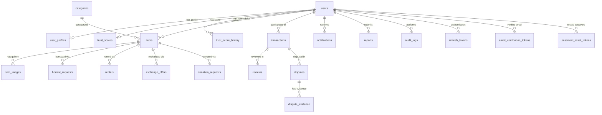

# ReCircle — MySQL 9.5 Database Schema & Entity-Relationship Diagram

## 1. MySQL 9.5 Verification Summary
- **Database Engine**: MySQL Server `9.5.0` (`InnoDB`, character set `utf8mb4`, collation `utf8mb4_0900_ai_ci`)
- **Total Tables**: `21` normalized tables (`3NF`/`BCNF`)
- **Foreign Keys**: `37` enforced referential integrity constraints
- **Unique Constraints**: `10` enforced uniqueness constraints
- **CHECK Constraints**: `20` MySQL 9.5 native `CHECK` constraints

---

## 2. Entity-Relationship Diagram (Mermaid)

---

## 3. Complete 21-Table Inventory
1. `users`: Core identity, BCrypt password hash, SRM registration number, role (`STUDENT`, `MODERATOR`, `ADMIN`), and account status.
2. `user_profiles`: Academic department, year of study (`1`–`6`), contact number, hostel/block, preferred pickup spot, and completion percentage.
3. `categories`: 10 campus resource categories (`Books and Academic Materials`, `Electronics and Gadgets`, `Laboratory Equipment`, `Stationery`, `Sports Equipment`, `Bicycles and Transportation`, `Hostel Essentials`, `Clothing and Accessories`, `Musical Instruments`, `Other Resources`).
4. `items`: Resource listings across `BORROW`, `RENT`, `EXCHANGE`, and `DONATE` with optimistic locking (`version`).
5. `item_images`: Ordered gallery images for each listing.
6. `borrow_requests`: Date-range borrowing lifecycle (`PENDING`, `APPROVED`, `REJECTED`, `ACTIVE`, `RETURN_REQUESTED`, `COMPLETED`, `OVERDUE`, `CANCELLED`).
7. `exchange_offers`: Peer item-for-item swap proposals with dual handover confirmation (`proposer_handover_confirmed`, `receiver_handover_confirmed`).
8. `rentals`: Daily-rate rental bookings with backend-computed `rental_days`, `total_rental_amount`, and payment status (`NOT_REQUIRED`, `NOT_INTEGRATED`, `PENDING`, `PAID_SIMULATED`, `REFUNDED_SIMULATED`, `FAILED`).
9. `donation_requests`: Free resource donation requests enforcing single-recipient approval.
10. `transactions`: Unified immutable transaction ledger across all four sharing modes (`uq_transactions_code`).
11. `reviews`: Post-completion 1–5 star ratings enforcing one review per participant per transaction (`uq_review_tx_reviewer`).
12. `trust_scores`: Current 4-pillar trust score and classification tier (`EXCELLENT`, `TRUSTED`, `DEVELOPING`, `LOW_TRUST`).
13. `trust_score_history`: Append-only audit log of every trust score recalculation.
14. `notifications`: In-app notification center entries.
15. `disputes`: Transaction/item/user disputes with moderator assignment, resolution notes, and `penalty_applied` flag.
16. `dispute_evidence`: Supporting evidence items attached to disputes.
17. `reports`: Content/user flagging records.
18. `audit_logs`: Administrative and moderation action trail.
19. `refresh_tokens`: Revocable session refresh tokens (`uq_refresh_token`).
20. `email_verification_tokens`: Time-limited single-use 6-digit campus email OTPs.
21. `password_reset_tokens`: Single-use password recovery tokens (`uq_password_reset_token`).
