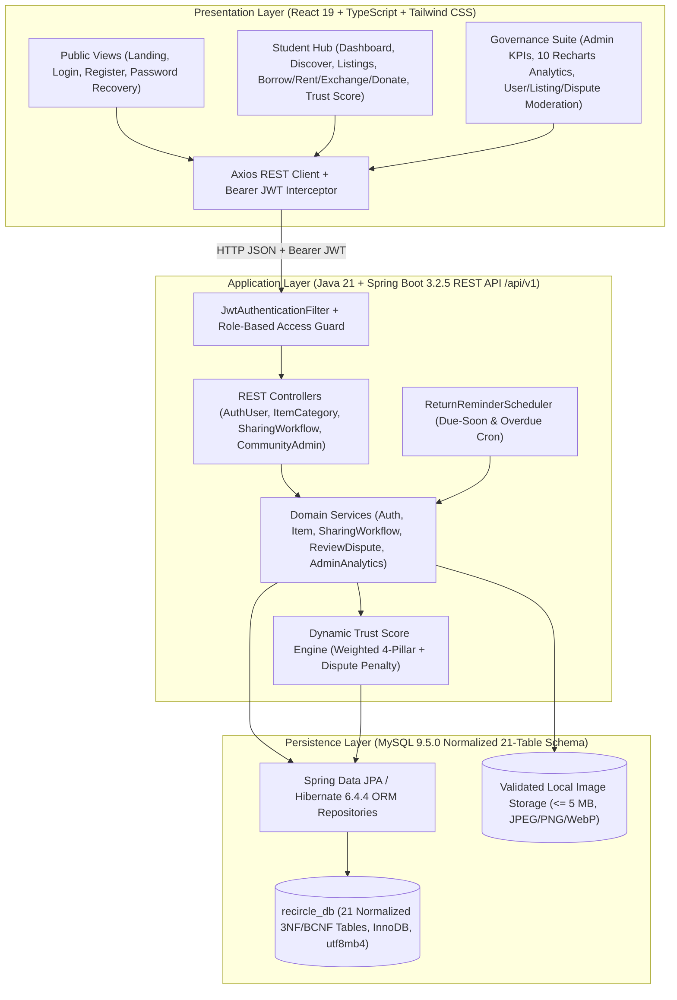

# ReCircle — System Architecture & Engineering Specification

## 1. Verified Toolchain & Runtime Stack
| Layer / Component | Selected Version | Verification Command |
| :--- | :--- | :--- |
| **Java Runtime & Compiler** | **OpenJDK 21.0.6 LTS** (`C:\Program Files\Android\Android Studio\jbr`) | `java -version` / `javac -version` (`21.0.6`) |
| **Backend Framework** | **Spring Boot `3.2.5`** (Spring Framework `6.1.6`, Hibernate ORM `6.4.4.Final`, Tomcat `10.1.20`) | `recircle\backend\mvnw.cmd test-compile -o` |
| **Build Tool** | **Apache Maven `3.8.4`** via **Maven Wrapper (`mvnw.cmd`)** | `recircle\backend\mvnw.cmd -version` |
| **Database Engine** | **MySQL Server `9.5.0`** (`InnoDB`, `utf8mb4_0900_ai_ci`) | `mysqld.exe --version` (`Ver 9.5.0 for Win64 on x86_64`) |
| **Frontend Runtime & Bundler** | **Node.js `v24.13.0`**, **React `19.2.3`**, **TypeScript `5.8.3`**, **Vite `8.1.3`**, **Tailwind CSS `4.2.0`** | `node -v` / `vite build` |

---

## 2. Three-Tier Full Stack Architecture

---

## 3. Core Business Rules Enforced in Code

### A. Date-Based Availability & Concurrency Protection
- **Separate Listing Status vs Reservation Status**: An item's `availability_status` (`AVAILABLE`, `UNAVAILABLE`, `ARCHIVED`, `COMPLETED`) represents its catalog listing state. Approving a date-scoped `BORROW` or `RENT` booking does **not** permanently lock the listing into `RESERVED`; instead, non-overlapping date windows remain bookable.
- **Pessimistic Row Locking & Optimistic Versioning**: During booking creation (`createBorrowRequest`, `createRentalRequest`) and approval (`approveBorrowRequest`, `approveRental`), `ItemRepository.findByIdForUpdate(itemId)` acquires a `PESSIMISTIC_WRITE` (`SELECT ... FOR UPDATE`) lock on the `items` row, and `@Version` columns protect `items`, `borrow_requests`, `exchange_offers`, `rentals`, and `donation_requests`.
- **Cross-Workflow Overlap Detection**: Both `borrowRequestRepository.existsOverlappingReservation` and `rentalRepository.existsOverlappingRental` evaluate `existing.startDate <= requestedEndDate AND existing.endDate >= requestedStartDate`. Overlapping bookings are rejected with HTTP `409 Conflict` (`OVERLAPPING_RESERVATION` / `OVERLAPPING_RENTAL`), and competing `PENDING` requests for the same dates are automatically declined when one request is approved.
- **Derived Date-Range Availability Endpoint**: `GET /api/v1/items/{id}/availability?startDate=YYYY-MM-DD&endDate=YYYY-MM-DD` derives real-time availability for any requested window and returns all active booking ranges.

### B. Payment Integrity
- **No False `PAID` Status on Approval**: Approving a rental (`PUT /api/v1/rentals/{id}/approve`) or confirming handover (`PUT /api/v1/rentals/{id}/confirm-handover`) never overwrites `paymentStatus` to `PAID` or `PAID_SIMULATED`.
- **Transparent Representation**: Without an external payment gateway, rental bookings default to `paymentStatus = PENDING` (or `NOT_INTEGRATED`), and optional simulated demo payments are explicitly labeled `PAID_SIMULATED` (`Simulate Demo Payment`).

### C. Trust-Score Integrity & Cold-Start Defaults
- **Weighted Four-Pillar Formula + Separate Dispute Penalty**:
  $$\text{Total Score} = \text{clamp}_{[0, 100]}\Big(0.15 \cdot S_{\text{verified}} + 0.35 \cdot S_{\text{tx}} + 0.30 \cdot S_{\text{review}} + 0.20 \cdot S_{\text{ontime}} - P_{\text{dispute}}\Big)$$
- **Component Definitions**:
  1. **Verified Account ($S_{\text{verified}}$, `15%`)**: `100.00` if `campus_verified == true`, else `0.00`.
  2. **Completed Transactions ($S_{\text{tx}}$, `35%`)**: $100 \times (1 - e^{-0.16 \cdot N_{\text{eff}}})$, where $N_{\text{eff}}$ deduplicates same-day, same-counterparty, same-type transactions to prevent artificial score farming.
  3. **User Reviews ($S_{\text{review}}$, `30%`)**: $(\bar{R} / 5.0) \times 100.0$ across non-flagged reviews; **neutral `50.00` baseline** for new users with `0` reviews.
  4. **On-Time Returns ($S_{\text{ontime}}$, `20%`)**: $(N_{\text{ontime}} / N_{\text{eligible}}) \times 100.0$ across completed borrowings and rentals; **neutral `50.00` baseline** for users with `0` eligible returns.
  5. **Dispute Penalty ($P_{\text{dispute}}$)**: `15.00` points per resolved dispute where an authorized Moderator/Admin explicitly sets `status = RESOLVED` and `penalizeReportedUser = true`.
- **Audit Trail**: Every score initialization and recalculation is logged in `trust_score_history`.

### D. Multi-Mode Resource Sharing State Machines (Sprint 2)
- **Exchange Ascending-ID Lock & Dual Handover Confirmation (`US11`)**:
  - Both `createExchangeOffer` and `acceptExchangeOffer` acquire `PESSIMISTIC_WRITE` row locks on the two items in strictly **ascending ID order** (`Math.min(requestedItemId, offeredItemId)` followed by `Math.max(requestedItemId, offeredItemId)`) to prevent cross-item deadlocks.
  - Exchange completion requires **both** participants (`proposerHandoverConfirmed` and `receiverHandoverConfirmed`) to confirm physical handover (`ACCEPTED -> HANDOVER_PENDING -> COMPLETED`). Calling `/complete` unilaterally before both parties confirm is rejected with HTTP `400 Bad Request` (`DUAL_HANDOVER_REQUIRED`).
- **Single-Recipient Donation & Atomic Competing Request Rejection (`US13`)**:
  - When a donor approves a donation request (`PUT /api/v1/donations/requests/{id}/approve`), `SharingWorkflowService` locks the item row via `PESSIMISTIC_WRITE`, marks the item `RESERVED`, and atomically transitions all competing `PENDING` donation requests for that item to `REJECTED` while updating their unified transaction ledger entries and notifying requesters.
- **Unified Transaction Ledger (`US14`)**:
  - Every `BORROW`, `RENT`, `EXCHANGE`, and `DONATE` workflow writes and updates a single canonical record in `transactions` keyed by `(transaction_type, reference_id)` with a unique `transaction_code` (`TX-BOR-...`, `TX-RNT-...`, `TX-EXC-...`, `TX-DON-...`).
