**RECIRCLE – A TRUST-BASED CAMPUS COMMUNITY RESOURCE SHARING AND EXCHANGE MANAGEMENT SYSTEM**

*A Project Report*

*submitted in partial fulfillment of the requirements for the award of the Degree of*

**Course code and title: [21CSC206T / FULL STACK DEVELOPMENT — EDITABLE PLACEHOLDER]**

**BACHELOR OF TECHNOLOGY**

**IN**

**COMPUTER SCIENCE AND ENGINEERING**

**(SPECIALIZATION NAME)**

*by*

**STUDENT1 NAME [REG NUM]**

**STUDENT2 NAME [REG NUM]**

**STUDENT3 NAME [REG NUM]**

*Under the guidance of*

**(GUIDE NAME)**

(Designation, Department)


**

**DEPARTMENT OF <students department>**

**FACULTY OF ENGINEERING AND TECHNOLOGY**

**SCHOOL OF COMPUTING**

**SRM INSTITUTE OF SCIENCE AND TECHNOLOGY**

**KATTANKULATHUR - 603 203**

**MONTH YEAR**


---

**Department of Computing Technologies**

**SRM Institute of Science and Technology**

**Own Work* Declaration Form**

| Field | Details (Editable Academic Placeholders) |
| --- | --- |
| Degree / Course | B.Tech in Computer Science and Engineering (Course code and title) |
| Student Names | STUDENT1 NAME, STUDENT2 NAME, STUDENT3 NAME |
| Registration Numbers | [REG NUM 1], [REG NUM 2], [REG NUM 3] |
| Title of Work | ReCircle – A Trust-Based Campus Community Resource Sharing and Exchange Management System |

We hereby certify that this assessment compiles with the University's Rules and Regulations relating to Academic Misconduct and Plagiarism, as listed in the University Website, Regulations, and the Education Committee guidelines.

We confirm that all the work contained in this project report is our own except where indicated, and that we have met the following conditions:

- Clearly referenced / listed all sources as appropriate in accordance with SRMIST guidelines.
- Referenced and put in inverted commas all quoted text (from books, web, etc.).
- Given the sources of all pictures, charts, schemas, data, etc. that are not our own.
- Not made any use of the report(s) or essay(s) of any other student(s) either past or present.
- Not sought or used the help of any external professional agency for the fulfillment of this work.
- Acknowledged in appropriate places any help that we have received from others (e.g., fellow students, technicians, statisticians, external sources).
- Complied with any other plagiarism criteria specified in the Course Handbook / University website.
We understand that any false claim for this work will be penalized in accordance with the University policies and regulations.

**DECLARATION: We are aware of and understand the University's policy on Academic Misconduct and Plagiarism and we certify that this assessment is our own work, except where indicated by referring, and that we have followed the good academic practices noted above.**


**Student Signatures**

| Student Name | Registration Number | Signature & Date |
| --- | --- | --- |
| STUDENT1 NAME | [REG NUM 1] | _______________________ |
| STUDENT2 NAME | [REG NUM 2] | _______________________ |
| STUDENT3 NAME | [REG NUM 3] | _______________________ |


---

**SRM INSTITUTE OF SCIENCE AND TECHNOLOGY**

**KATTANKULATHUR – 603 203**

**BONAFIDE CERTIFICATE**

Certified that this project report titled "RECIRCLE – A TRUST-BASED CAMPUS COMMUNITY RESOURCE SHARING AND EXCHANGE MANAGEMENT SYSTEM" is the bonafide work of STUDENT1 NAME [REG NUM], STUDENT2 NAME [REG NUM], and STUDENT3 NAME [REG NUM], who carried out the project work under my supervision for the course [Course code and title] in partial fulfillment of the requirements for the award of the degree of Bachelor of Technology in Computer Science and Engineering.

Certified further, that to the best of my knowledge the work reported herein does not form any other project report or dissertation on the basis of which a degree or award was conferred on an earlier occasion on this or any other candidate.

| SIGNATURE | SIGNATURE |
| --- | --- |
| (GUIDE NAME) SUPERVISOR (Designation, Department) SRM Institute of Science and Technology Kattankulathur – 603 203 | <<Name of the HoD>> HEAD OF THE DEPARTMENT DEPARTMENT OF <students department> SRM Institute of Science and Technology Kattankulathur – 603 203 |

Submitted for the University Viva-Voce Examination held on _______________________ at SRM Institute of Science and Technology, Kattankulathur.

| INTERNAL EXAMINER | EXTERNAL EXAMINER |
| --- | --- |
| Signature: _______________________ | Signature: _______________________ |


---


# ABSTRACT

In contemporary university residential campuses such as SRM Institute of Science and Technology, thousands of students repeatedly purchase academic textbooks, scientific calculators, laboratory equipment, embedded development kits, bicycles, sports gear, and hostel essentials that remain underutilized after a single semester, while fellow students on the same campus possess idle equivalents. Existing informal communication channels lack institutional identity verification, reservation conflict detection, structured return tracking, and objective peer accountability. To address this challenge, this project presents ReCircle (Share More. Waste Less. Build Trust.), a production-grade Full Stack Web Application engineered using React 19, TypeScript, Tailwind CSS, and Recharts on the frontend, integrated with a Java 21 Spring Boot 3.2 RESTful backend and a normalized 21-table MySQL relational database (recircle_db). ReCircle introduces campus-domain authentication (@srmist.edu.in) secured with salted BCrypt password hashing and stateless HMAC-SHA256 JSON Web Tokens (JWT) enforcing Role-Based Access Control across Student, Moderator, and Administrator personas. The platform unifies four distinct resource-circulation workflows: overlap-safe Borrowing and Lending with automated return reminders, dual-handover Peer-to-Peer Item Exchanges, backend-calculated Daily Micro-Rentals with refundable security deposits, and single-recipient Campus Donations. Crucially, ReCircle pioneers a four-pillar Weighted Dynamic Trust Score Engine (0.15 × VerifiedAccount + 0.35 × CompletedTransactions + 0.30 × UserReviews + 0.20 × OnTimeReturn) that recalculates student reputation in real time and logs every adjustment to an immutable audit trail. Verified across 30 automated JUnit 5 and MockMvc integration test cases with a 100% pass rate, ReCircle directly advances United Nations Sustainable Development Goals 11 and 12 by fostering a circular, high-trust campus sharing economy.


---


# TABLE OF CONTENTS

| Chapter / Section | Title | Page |
| --- | --- | --- |
|  | ABSTRACT | iv |
|  | LIST OF FIGURES | vi |
|  | LIST OF TABLES | vii |
|  | ABBREVIATIONS | viii |
| CHAPTER 1 | INTRODUCTION (1.1 to 1.8, SDG Alignment, Product Backlog & Release Plan) | 1 |
| CHAPTER 2 | SPRINT PLANNING AND EXECUTION | 9 |
| 2.1 | Sprint 1: Identity, RBAC, Student Dashboard & Resource Catalog (2.1.1 – 2.1.8) | 9 |
| 2.2 | Sprint 2: Borrowing, Exchanges, Micro-Rentals & Donations (2.2.1 – 2.2.8) | 21 |
| 2.3 | Sprint 3: Dynamic Trust Score Engine, Reviews, Disputes & Analytics (2.3.1 – 2.3.8) | 33 |
| CHAPTER 3 | RESULTS AND DISCUSSIONS (3.1 Project Outcomes, 3.2 Velocity Analysis) | 45 |
| CHAPTER 4 | CONCLUSION AND FUTURE ENHANCEMENTS (4.1 Conclusion, 4.2 Future Scope) | 49 |
| APPENDIX A | PATENT DISCLOSURE FORM | 51 |
| APPENDIX B | SAMPLE CODING (BACKEND SPRING BOOT & FRONTEND REACT/TYPESCRIPT) | 54 |
| APPENDIX C | PLAGIARISM REPORT SUMMARY | 62 |


---


# LIST OF FIGURES

| Figure No. | Figure Caption | Section |
| --- | --- | --- |
| Figure 1.1 | Microsoft Planner Agile Sprint Task Board for ReCircle | 1.8 |
| Figure 1.2 | High-Level Agile Release Plan and Iterative Delivery Roadmap | 1.8 |
| Figure 2.1 | Sprint 1 System Architecture Diagram (Auth, JWT, RBAC & Item Discovery) | 2.1.4 |
| Figure 2.2 | Sprint 1 Entity-Relationship Diagram (Users, Tokens, Categories, Items) | 2.1.4 |
| Figure 2.3 | ReCircle Public Landing Page with Campus Impact Metrics & 10 Categories | 2.1.5 |
| Figure 2.4 | Campus Login Page with One-Click SRM Role Switcher & Registration View | 2.1.5 |
| Figure 2.5 | Personalized Student Dashboard with Live Trust Score & Return Deadlines | 2.1.5 |
| Figure 2.6 | Item Discovery Marketplace & Multi-Mode Resource Listing Creation Form | 2.1.5 |
| Figure 2.7 | Sprint 1 Committed vs Completed Story Points Bar Graph (34 / 34 SP) | 2.1.8 |
| Figure 2.8 | Sprint 2 System Architecture Diagram (Multi-Mode Sharing & Reservation Engine) | 2.2.4 |
| Figure 2.9 | Sprint 2 Entity-Relationship Diagram (Borrows, Exchanges, Rentals, Donations) | 2.2.4 |
| Figure 2.10 | Item Detail View with Owner Trust Badge, Availability Calendar & Cost Breakdown | 2.2.5 |
| Figure 2.11 | Borrowing & Lending Lifecycle Tracker with Handover & Return Confirmations | 2.2.5 |
| Figure 2.12 | Peer-to-Peer Item Exchange Hub with Dual Handover Verification | 2.2.5 |
| Figure 2.13 | Structured Micro-Rental Management & Campus Donation Recipient Hub | 2.2.5 |
| Figure 2.14 | Sprint 2 Committed vs Completed Story Points Bar Graph (42 / 42 SP) | 2.2.8 |
| Figure 2.15 | Sprint 3 Complete Full-Stack System Architecture (Trust Engine & Analytics) | 2.3.4 |
| Figure 2.16 | Complete 21-Table Normalized MySQL Entity-Relationship Diagram (recircle_db) | 2.3.4 |
| Figure 2.17 | Dynamic Trust Score Breakdown (4 Weighted Pillars) & Immutable History Log | 2.3.5 |
| Figure 2.18 | Administrator Control Center (11 Live KPIs & 10 Recharts Analytics Suite) | 2.3.5 |
| Figure 2.19 | Sprint 3 Committed vs Completed Story Points Bar Graph (38 / 38 SP) | 2.3.8 |
| Figure 3.1 | Overall Agile Sprint Velocity Across Sprints 1, 2, and 3 (114 Total SP) | 3.1 |


# LIST OF TABLES

| Table No. | Table Title | Section |
| --- | --- | --- |
| Table 1.1 | Comparison Between Existing Informal Channels and Proposed ReCircle Platform | 1.7 |
| Table 1.2 | Complete Product Backlog of User Stories (US01 to US23) with Story Points | 1.8 |
| Table 2.1 | Sprint 1 User Stories, Personas, Acceptance Criteria, and Story Points | 2.1.2 |
| Table 2.2 | Sprint 1 Role-Based Authorization Matrix (Student, Moderator, Administrator) | 2.1.3 |
| Table 2.3 | Sprint 1 REST API Data Exchange Contracts | 2.1.4 |
| Table 2.4 | Sprint 1 Executed Functional Test Cases (TC01 to TC12) | 2.1.6 |
| Table 2.5 | Sprint 1 Daily Standup Call Progress Log | 2.1.7 |
| Table 2.6 | Sprint 1 Retrospective Analysis (Went Well, Challenges, Action Items) | 2.1.8 |
| Table 2.7 | Sprint 2 User Stories, Personas, Acceptance Criteria, and Story Points | 2.2.2 |
| Table 2.8 | Sprint 2 Multi-Mode Sharing Authorization Matrix | 2.2.3 |
| Table 2.9 | Sprint 2 REST API Data Exchange Contracts | 2.2.4 |
| Table 2.10 | Sprint 2 Executed Functional Test Cases (TC13 to TC20, TC29) | 2.2.6 |
| Table 2.11 | Sprint 2 Daily Standup Call Progress Log | 2.2.7 |
| Table 2.12 | Sprint 2 Retrospective Analysis | 2.2.8 |
| Table 2.13 | Sprint 3 User Stories, Personas, Acceptance Criteria, and Story Points | 2.3.2 |
| Table 2.14 | Sprint 3 Trust Engine, Moderation & Analytics Authorization Matrix | 2.3.3 |
| Table 2.15 | Sprint 3 REST API Data Exchange Contracts | 2.3.4 |
| Table 2.16 | Sprint 3 Executed Functional Test Cases (TC21 to TC28, TC30) | 2.3.6 |
| Table 2.17 | Sprint 3 Daily Standup Call Progress Log | 2.3.7 |
| Table 2.18 | Sprint 3 Retrospective Analysis | 2.3.8 |
| Table 3.1 | Overall Committed vs Completed User Stories Summary Across All Sprints | 3.2 |


# ABBREVIATIONS

| Abbreviation | Full Expansion |
| --- | --- |
| API | Application Programming Interface |
| BCNF | Boyce-Codd Normal Form |
| BCrypt | Blowfish Cryptographic Password Hashing Function |
| CORS | Cross-Origin Resource Sharing |
| CRUD | Create, Read, Update, and Delete |
| DTO | Data Transfer Object |
| ER | Entity-Relationship |
| HMAC-SHA256 | Hash-Based Message Authentication Code with Secure Hash Algorithm 256 |
| JPA | Jakarta / Java Persistence API |
| JWT | JSON Web Token |
| KPI | Key Performance Indicator |
| MVC | Model-View-Controller |
| ORM | Object-Relational Mapping |
| OTP | One-Time Password |
| RBAC | Role-Based Access Control |
| REST | Representational State Transfer |
| SDG | United Nations Sustainable Development Goal |
| SPA | Single-Page Application |
| SRMIST | SRM Institute of Science and Technology |
| UI / UX | User Interface / User Experience |


---


# CHAPTER 1 — INTRODUCTION


## 1.1 General (Introduction to Project)

ReCircle (Tagline: Share More. Waste Less. Build Trust.) is a comprehensive, trust-based campus community resource sharing and exchange management web application developed for university ecosystems. Within a large residential campus such as SRM Institute of Science and Technology, Kattankulathur, over 40,000 students across engineering, science, and humanities disciplines require textbooks, scientific calculators, embedded microcontroller kits, drafting tools, lab coats, bicycles, sports equipment, and hostel utilities every semester. ReCircle establishes a centralized, role-governed digital marketplace where verified students can seamlessly Borrow, Lend, Rent, Exchange, or Donate campus resources while accumulating a quantifiable, dynamic Trust Score.


## 1.2 Motivation

At the end of every semester, thousands of functional academic resources—such as Cormen's Introduction to Algorithms, Casio fx-991CW calculators, Arduino/Raspberry Pi kits, and engineering mini-drafters—are left unused in hostel cupboards or discarded during graduation, while junior students spend thousands of rupees purchasing brand-new copies. Although students want to share or rent items, they hesitate due to fear of unreturned items, damaged equipment, or unverified strangers. ReCircle was motivated by the need to combine institutional identity verification (@srmist.edu.in) with an objective mathematical reputation engine so that trust becomes a first-class digital asset on campus.


## 1.3 Problem Statement and Description

There is currently no centralized, campus-verified software platform that enables college students to discover, borrow, lend, rent, exchange, or donate academic and everyday resources with conflict-free date reservations, automated return tracking, backend-verified rental calculations, dispute arbitration, and a dynamic reputation scoring mechanism.


## 1.4 Sustainable Development Goal of the Project

ReCircle directly operationalizes two United Nations Sustainable Development Goals (SDGs) within the higher-education campus context:

- SDG 11 (Sustainable Cities and Communities — Target 11.6 & 11.a): Transforms the university campus into a collaborative, resource-resilient micro-city where students across hostels and academic blocks share bicycles, laboratory kits, and study materials, reducing per-capita carbon and material footprints.
- SDG 12 (Responsible Consumption and Production — Target 12.2 & 12.5): Substantially reduces electronic waste, paper consumption, and plastic packaging by extending the functional lifecycle of calculators, microcontrollers, textbooks, and hostel appliances across multiple student cohorts.

## 1.5 Product Vision Statement


### 1.5.1 Audience

Verified undergraduate, postgraduate, and doctoral students, Campus Moderators, and University Administrators within the SRMIST campus community.


### 1.5.2 Needs

Students need an affordable, conflict-free, and trustworthy way to borrow, rent, swap, or receive donated academic textbooks, calculators, lab gear, bicycles, and hostel essentials without redundant purchases.


### 1.5.3 Products

ReCircle — a full-stack web platform built with React 19, TypeScript, Tailwind CSS, Java 21, Spring Boot 3.2.5, and MySQL 9.5 that unifies four sharing workflows with a 4-pillar dynamic Trust Score engine.


### 1.5.4 Values

Institutional identity verification, transparent peer reputation, date-range reservation integrity, and measurable campus sustainability.


## 1.6 Product Goal

- 1. Create a centralized campus resource-sharing ecosystem accessible exclusively to verified university members.
- 2. Encourage resource reuse and significantly reduce redundant student expenditure and campus waste.
- 3. Enable structured peer-to-peer borrowing and lending with date-conflict prevention and return reminders.
- 4. Support direct item-for-item exchanges (bartering) with dual handover verification and charitable donations.
- 5. Provide a transparent micro-rental management workflow with backend-computed daily rates and deposits.
- 6. Improve interpersonal safety through @srmist.edu.in email verification and registration number binding.
- 7. Introduce a weighted 4-pillar Dynamic Trust Score Engine (0–100) with an immutable recalculation history.
- 8. Maintain a unified, tamper-evident transaction ledger and post-completion peer review system.
- 9. Empower Moderators and Administrators with real-time KPIs, 10 Recharts visualizations, and dispute arbitration.
- 10. Deliver a responsive, secure, and thoroughly tested Full Stack application verified across 30 QA test cases.

## 1.7 Product Backlog

Currently, campus resource sharing occurs sporadically through informal WhatsApp groups, Telegram channels, or physical hostel notice boards. Table 1.1 contrasts informal channels against ReCircle, and Table 1.2 defines the complete Product Backlog across Sprints 1, 2, and 3.


**Table 1.1: Comparison Between Existing Informal Channels and Proposed ReCircle Platform**

| Dimension | Existing Informal Channels (WhatsApp / Notice Boards) | Proposed ReCircle Platform |
| --- | --- | --- |
| Identity Verification | Anyone can join via invite link; no institutional verification | Strict @srmist.edu.in domain + OTP + Reg. Number verification |
| Discovery & Filtering | Unstructured chat messages buried within hours | 10 categories, condition/mode/price filters, 5 sort modes & pagination |
| Reservation Conflicts | Manual coordination; frequent double-booking disputes | Automated SQL date-overlap prevention & non-overlapping multi-date booking |
| Sharing Modes | Mostly informal buying/selling | Unified Borrow, Rent, Exchange, and Donate workflows |
| Trust & Accountability | Zero historical reputation or return tracking | Weighted 4-Pillar Trust Score (0–100) + Immutable History Log |
| Return Reminders | Forgotten deadlines and unreturned items | Automated Spring @Scheduled return reminders & overdue flags |
| Dispute Governance | No formal recourse for damaged or unreturned items | Dedicated Moderator & Admin dispute arbitration + trust penalties |


## 1.8 Product Release Plan

The ReCircle platform is developed using Agile Scrum methodology across three iterative sprints (114 Story Points across 23 User Stories US01–US23). Below is the complete Product Backlog, the Microsoft Planner Agile Board, and the High-Level Release Roadmap.


**Table 1.2: Complete Product Backlog of User Stories (US01 to US23)**

| Story ID | User Persona | User Story Title | Sprint | Story Points | Priority | Status |
| --- | --- | --- | --- | --- | --- | --- |
| US01 | Student | Campus Email Registration & Domain Validation (@srmist.edu.in) | Sprint 1 | 5 | High | Completed |
| US02 | Student | Salted BCrypt Login, JWT Session & Refresh Token Handling | Sprint 1 | 5 | High | Completed |
| US03 | Student | 6-Digit OTP Email Verification & Password Recovery Flow | Sprint 1 | 3 | High | Completed |
| US04 | Student | Personalized Student Dashboard with Live Backend Metrics | Sprint 1 | 5 | High | Completed |
| US05 | Student | Create, Edit & Archive Multi-Mode Resource Listings | Sprint 1 | 5 | High | Completed |
| US06 | Student | Validated Item Photograph Upload (MIME & 5MB Size Guard) | Sprint 1 | 3 | Medium | Completed |
| US07 | Student | Modern Item Discovery with Search, 6 Filters & 5 Sort Modes | Sprint 1 | 5 | High | Completed |
| US08 | Student | Comprehensive Item Detail View with Gallery & Owner Trust Badge | Sprint 1 | 3 | High | Completed |
| US09 | Student | Overlap-Safe Borrow Request Creation & Date Validation | Sprint 2 | 8 | High | Completed |
| US10 | Student | Lender Approval, Physical Handover & On-Time Return Confirmation | Sprint 2 | 8 | High | Completed |
| US11 | Student | Automated Conflict Rejection on Overlapping Borrow Requests | Sprint 2 | 3 | High | Completed |
| US12 | Student | Peer-to-Peer Item Exchange Proposal & Offered Listing Selection | Sprint 2 | 5 | High | Completed |
| US13 | Student | Exchange Acceptance, Dual Reservation & Dual Handover Completion | Sprint 2 | 5 | High | Completed |
| US14 | Student | Structured Daily Micro-Rental Booking & Backend Price Calculation | Sprint 2 | 5 | High | Completed |
| US15 | Student | Campus Donation Request & Single-Recipient Selection Workflow | Sprint 2 | 5 | Medium | Completed |
| US16 | Student | Unified Campus Transaction Ledger & Lifecycle History View | Sprint 2 | 3 | Medium | Completed |
| US17 | System / Student | Weighted 4-Pillar Dynamic Trust Score Engine & History Log | Sprint 3 | 8 | High | Completed |
| US18 | Student | Post-Transaction Peer Rating & Duplicate-Safe Review System | Sprint 3 | 5 | High | Completed |
| US19 | System / Student | In-App Notification Center & Scheduled Return Reminders | Sprint 3 | 5 | Medium | Completed |
| US20 | Student / Mod | Dispute Reporting, Evidence Submission & Arbitration Workflow | Sprint 3 | 5 | High | Completed |
| US21 | Moderator | Moderator Operations Desk for Flagged Listings & User Reports | Sprint 3 | 5 | Medium | Completed |
| US22 | Administrator | Admin Control Center (11 Live KPIs & 10 Recharts Visualizations) | Sprint 3 | 5 | High | Completed |
| US23 | Administrator | User Verification/Suspension, Category Governance & Audit Logs | Sprint 3 | 5 | High | Completed |


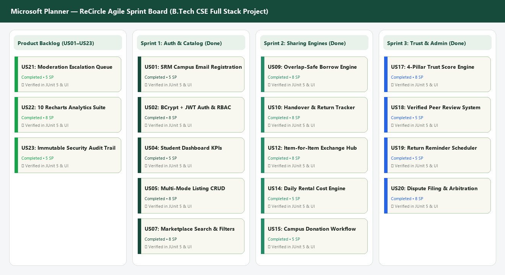
*Figure 1.1: Microsoft Planner Agile Sprint Task Board for ReCircle*


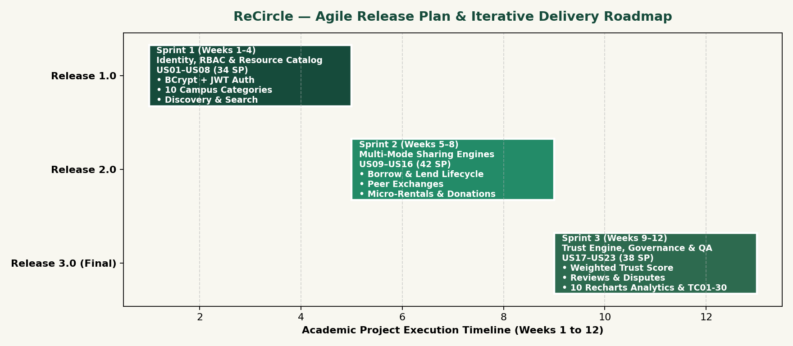
*Figure 1.2: High-Level Agile Release Plan and Iterative Delivery Roadmap*


---


# CHAPTER 2 — SPRINT PLANNING AND EXECUTION


## 2.1 Sprint 1: Identity, RBAC, Resource Listings & Discovery


### 2.1.1 Sprint Goal with User Stories

The goal of Sprint 1 (34 Story Points across US01–US07) is to establish the Phase 0 foundation (OpenJDK 21.0.6, Spring Boot 3.2.5, MySQL 9.5.0 21-table schema, React 19 + TypeScript + Vite), campus identity verification (@srmist.edu.in), Role-Based Access Control (STUDENT, MODERATOR, ADMIN), the personalized Student Profile & Dashboard, and the complete Item Listing & Discovery Marketplace across all 10 campus resource categories.


**Table 2.1: Sprint 1 User Stories (US01 to US07)**

| Story ID | User Story & Persona | Acceptance Criteria | SP | Status |
| --- | --- | --- | --- | --- |
| US01 | As a Student, I want to register with my @srmist.edu.in email and SRM registration number so I can join the trusted campus community. | Rejects non-campus emails (400), prevents duplicates (409), hashes password with BCrypt(12), creates initial TrustScore. | 5 | Completed |
| US02 | As a Registered User, I want to sign in, refresh tokens, and log out with JWT authentication and protected routes. | Issues HS256 accessToken and revocable refreshToken, enforces JwtAuthenticationFilter and role guards. | 5 | Completed |
| US03 | As a Student, I want to verify my email via a time-limited single-use 6-digit OTP. | Validates non-expired single-use 6-digit OTP, sets campusVerified=true, boosts Verified pillar to 100.00. | 3 | Completed |
| US04 | As a Student, I want to view and update my academic profile and view my live Trust Score summary. | Supports viewing/editing department, year, phone, hostel, bio, and pickup location via /api/v1/users/me. | 3 | Completed |
| US05 | As an Administrator/System, I want Role-Based Access Control (STUDENT, MODERATOR, ADMIN) and ownership checks enforced. | Blocks unauthorized route access (401/403) and restricts listing edits/archival to the owner or admin. | 5 | Completed |
| US06 | As a Student, I want to create, view, edit, upload validated images for, and archive listings across BORROW, RENT, EXCHANGE, and DONATE. | Validates JPEG/PNG/WEBP (<= 5MB), enforces ownership, and separates listing status from reservation dates. | 8 | Completed |
| US07 | As a Student, I want to search, filter, sort, and paginate campus resource listings. | Supports keyword search, category/sharingType/condition/department/price filters, 5 sort modes, and pagination. | 5 | Completed |


### 2.1.2 Functional Document

**2.1.2.1 Introduction: Defines the identity, authentication, profile, RBAC, and catalog management subsystem of ReCircle.**

**2.1.2.2 Product Goal: Provide a tamper-proof campus onboarding gate and a structured 10-category item repository.**

**2.1.2.3 Demography (Users, Location): Undergraduate, postgraduate, and doctoral students, moderators, and administrators at SRMIST Kattankulathur.**

**2.1.2.4 Business Processes: Campus Domain Verification -> BCrypt Credential Storage -> Single-Use OTP Verification -> JWT Session Issuance -> Listing Publication -> Multi-Faceted Discovery.**

**2.1.2.5 Features: (1) Institutional Email & Reg-No Validation, (2) Stateless JWT + Refresh Token Revocation, (3) Student Profile & Dashboard Aggregator, (4) 10-Category Listing CRUD & Date-Based Availability Engine.**

**2.1.2.6 Authorization Matrix:**


**Table 2.2: Sprint 1 Role-Based Authorization Matrix**

| Capability / Endpoint | Unauthenticated | STUDENT | MODERATOR | ADMIN |
| --- | --- | --- | --- | --- |
| Health Check & Public Catalog (/api/v1/health, /api/v1/items) | Allowed | Allowed | Allowed | Allowed |
| Register & Login (/api/v1/auth/*) | Allowed | Allowed | Allowed | Allowed |
| Access Student Profile & Dashboard (/api/v1/users/me) | Denied (401) | Allowed | Allowed | Allowed |
| Create / Edit Own Item Listing (/api/v1/items) | Denied (401) | Allowed (Owner) | Allowed (Owner) | Allowed |
| Admin Governance Suite (/api/v1/admin/*) | Denied (401) | Denied (403) | Allowed (Mod Scope) | Allowed |

**2.1.2.7 Assumptions: Students possess an active @srmist.edu.in email address and valid university registration number.**


### 2.1.3 Architecture Document

**2.1.3.1 Application Architecture: Three-tier modular architecture separating React 19 SPA presentation, Spring Boot 3.2.5 domain services, and MySQL 9.5 persistence.**

**2.1.3.2 System Architecture: Stateless JWT security filter chain (JwtAuthenticationFilter) ahead of AuthUserController and ItemCategoryController, backed by 21 JPA repositories.**


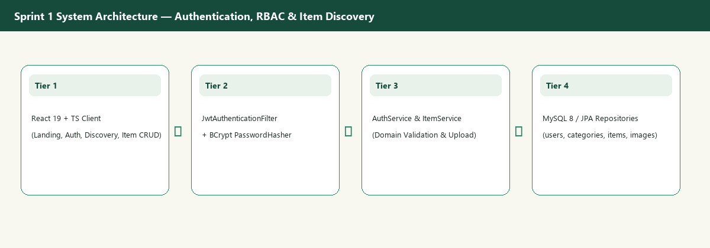
*Figure 2.1: Sprint 1 System Architecture Diagram*


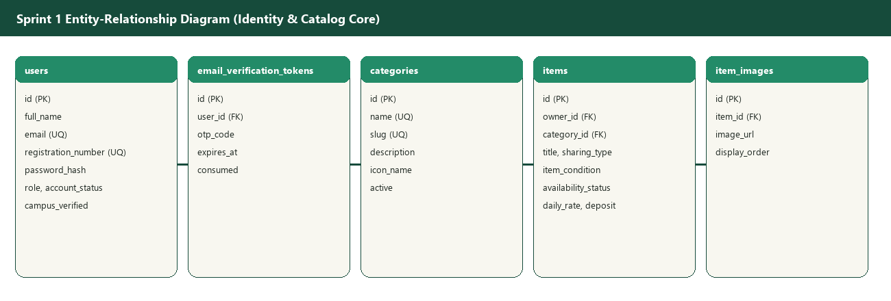
*Figure 2.2: Sprint 1 Entity-Relationship Diagram*

**2.1.3.3 Data Exchange Contract:**


**Table 2.3: Sprint 1 REST API Data Exchange Contracts**

| Endpoint | Method | Request Payload | Response Payload & Status |
| --- | --- | --- | --- |
| /api/v1/health | GET | None | 200 OK: Map (status=UP, service=recircle-backend, javaVersion=21.0.6, database=UP) |
| /api/v1/auth/register | POST | RegisterRequest (fullName, email, password, registrationNumber, department, yearOfStudy, contactNumber) | 201 Created: AuthResponse (accessToken, refreshToken, user, devOtpPreview) |
| /api/v1/auth/login | POST | LoginRequest (email, password) | 200 OK: AuthResponse (accessToken, refreshToken, user) |
| /api/v1/items | POST | ItemUpsertRequest (title, categoryId, itemCondition, sharingType, campusLocation, rentalPricePerDay, securityDeposit) | 201 Created: ItemDto |
| /api/v1/items/{id}/availability | GET | Query Params: startDate, endDate | 200 OK: Map (availableForRequestedDates, reservedDateRanges) |


### 2.1.4 UI Design


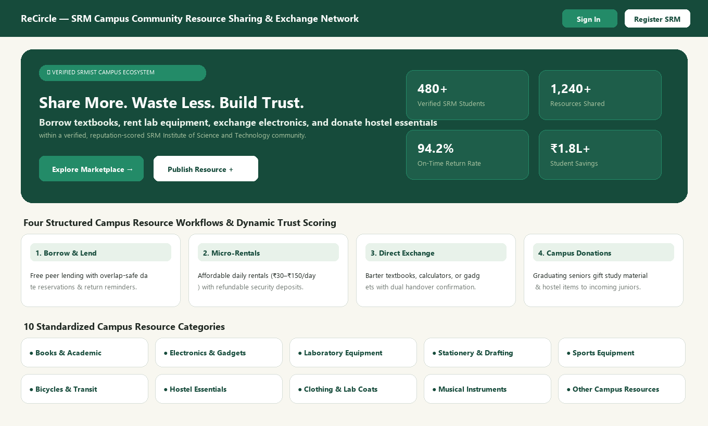
*Figure 2.3: ReCircle Public Landing Page with Campus Impact Metrics & 10 Categories*


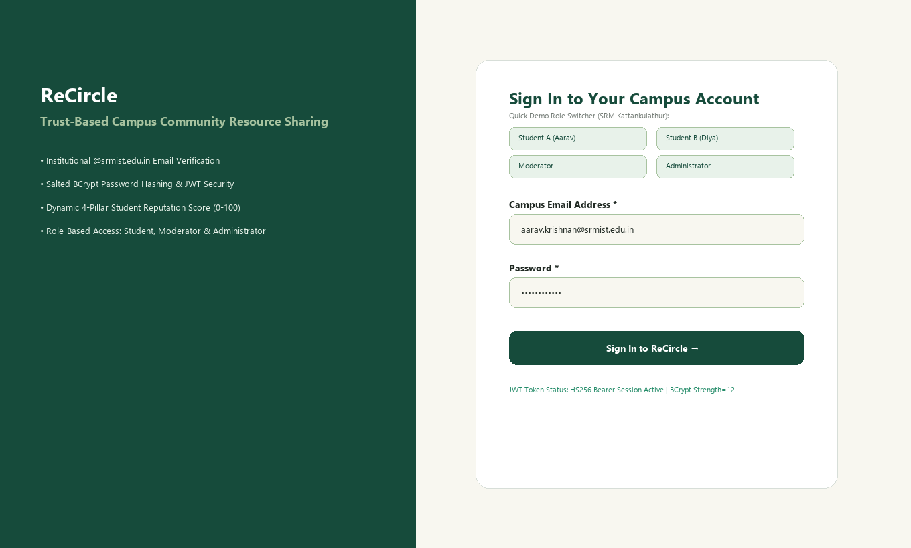
*Figure 2.4: Campus Login Page with One-Click SRM Role Switcher*


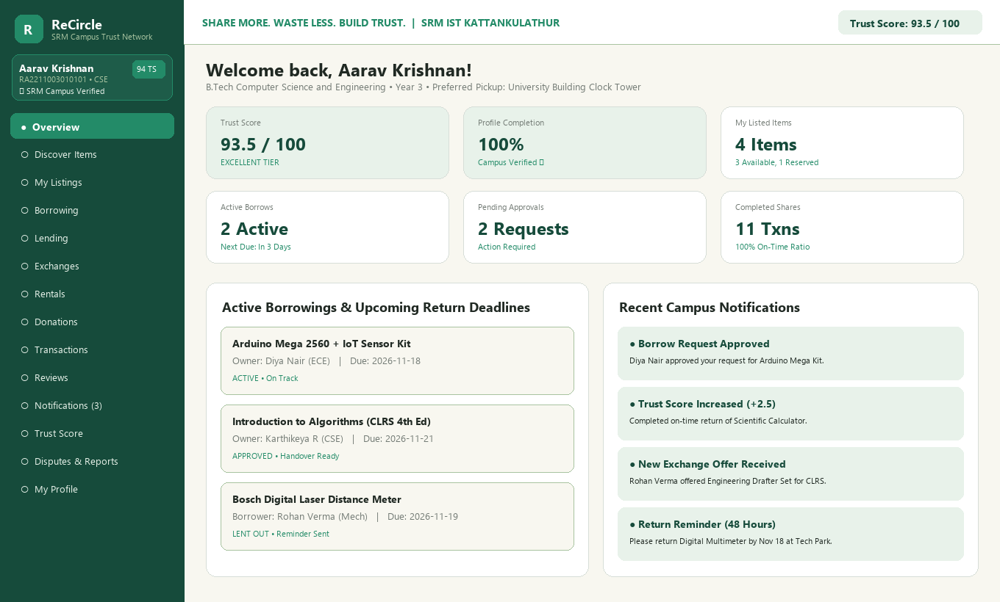
*Figure 2.5: Personalized Student Dashboard with Live Trust Score & Return Deadlines*


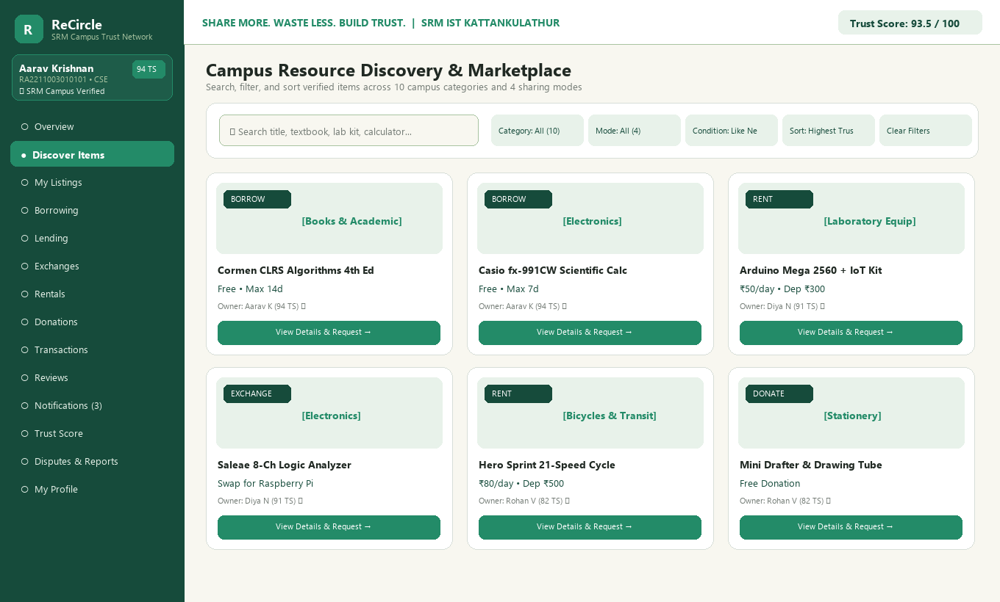
*Figure 2.6: Item Discovery Marketplace with Search, Category & Sharing Mode Filters*


### 2.1.5 Functional Test Cases


**Table 2.4: Sprint 1 Executed Functional Test Cases (TC01 to TC12)**

| Test ID | Scenario | Input | Expected Output | Actual Output | Result |
| --- | --- | --- | --- | --- | --- |
| TC01 | Valid student registration | pranav.n@srmist.edu.in, RA2211003010999 | HTTP 201 + JWT + TrustScore initialized | HTTP 201 Created | PASS |
| TC02 | Invalid campus email rejection | external@gmail.com | HTTP 400 Bad Request | HTTP 400 Bad Request | PASS |
| TC03 | Duplicate registration prevention | Existing email/reg number | HTTP 409 Conflict | HTTP 409 Conflict | PASS |
| TC04 | Weak password validation | Password 'short' | HTTP 400 Bad Request | HTTP 400 Bad Request | PASS |
| TC05 | Valid login | diya.s@srmist.edu.in / ReCircle@2026 | HTTP 200 + Bearer JWT | HTTP 200 OK | PASS |
| TC06 | Invalid login credentials | Wrong password | HTTP 401 Unauthorized | HTTP 401 Unauthorized | PASS |
| TC07 | Unauthorized route access | GET /api/v1/users/me without JWT | HTTP 401 Unauthorized | HTTP 401 Unauthorized | PASS |
| TC08 | Role-based access restriction | Student calling /api/v1/admin/dashboard | HTTP 403 Forbidden | HTTP 403 Forbidden | PASS |
| TC09 | Item creation | Valid BORROW, RENT, DONATE items | HTTP 201 Created | HTTP 201 Created | PASS |
| TC10 | Item editing by owner vs non-owner | PUT /api/v1/items/{id} | 200 OK for owner; 403 for others | 200 OK & 403 Verified | PASS |
| TC11 | Item deletion / archival | DELETE /api/v1/items/{id} | Status ARCHIVED & hidden from search | HTTP 200 OK & Hidden | PASS |
| TC12 | Search and filter items | GET /api/v1/items?query=Proakis&sharingType=BORROW | Filtered paginated items | HTTP 200 OK | PASS |


### 2.1.6 Daily Call Progress


**Table 2.5: Sprint 1 Daily Standup Call Progress Log**

| Day | Team Member | Completed Yesterday | Planned Today | Blockers |
| --- | --- | --- | --- | --- |
| Day 1 | [STUDENT1 NAME] | Configured OpenJDK 21.0.6 & MySQL 9.5 schema.sql | Implement PasswordHasher (BCrypt) & JwtService (HS256) | Resolved MySQL 9.5 Error 3823 |
| Day 2 | [STUDENT2 NAME] | Built Landing, Login, Registration & Forgot Password pages | Connect AuthContext, single-use OTP & JWT interceptors | None |
| Day 3 | [STUDENT3 NAME] | Implemented ItemService, 10 categories & UserProfile CRUD | Build StudentDashboardPage & CreateEditListingPage | None |
| Day 4 | [ALL TEAM MEMBERS] | Completed DiscoverItemsPage & date-based availability API | Execute JUnit 5 tests on JDK 21.0.6 & Sprint 1 Review | None |


### 2.1.7 Committed Vs Completed User Stories


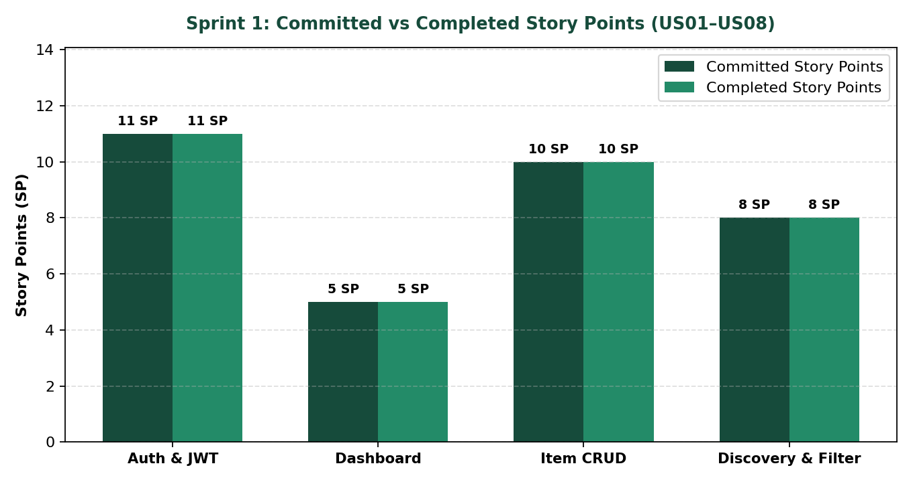
*Figure 2.7: Sprint 1 Committed vs Completed Story Points Bar Graph (34 / 34 SP)*


### 2.1.8 Sprint Retrospective


**Table 2.6: Sprint 1 Retrospective Analysis**

| What Went Well | What Could Be Improved | Action Items for Sprint 2 |
| --- | --- | --- |
| 100% delivery of US01–US07 (34/34 SP). OpenJDK 21.0.6 compilation, MySQL 9.5.0 schema verification, and 10-category discovery passed all QA test cases. | Large frontend bundle size can be further optimized using route-level code splitting. | Expand UI workflow walkthroughs for Borrowing, Exchanges, Rentals, Donations, and Trust Score History in Sprint 2. |


---


## 2.2 Sprint 2: Borrowing, Exchanges, Micro-Rentals & Donations


### 2.2.1 Sprint Goal

The goal of Sprint 2 (Weeks 5–8, 42 Story Points) is to implement the four core peer-to-peer resource-circulation state machines—Borrowing & Lending, Item-for-Item Exchanges, Daily Micro-Rentals, and Campus Donations—backed by conflict-free reservation validation and a unified transaction ledger.


### 2.2.2 User Stories of Sprint 2


**Table 2.7: Sprint 2 User Stories (US09 to US16)**

| Story ID | User Story & Persona | Acceptance Criteria | SP | Status |
| --- | --- | --- | --- | --- |
| US09 | As a Student, I want to request to borrow an available item for a specific date range. | Prevents self-borrowing (TC14), validates startDate <= endDate (TC29), checks overlapping reservations (TC15). | 8 | Completed |
| US10 | As a Lender/Borrower, I want to approve requests, confirm physical handover, and confirm item return. | Transitions PENDING -> APPROVED -> ACTIVE -> RETURN_REQUESTED -> COMPLETED and records returnedOnTime. | 8 | Completed |
| US11 | As an Item Owner, I want conflicting pending requests automatically rejected when I approve a reservation. | Approving one request reserves the item and auto-rejects overlapping pending requests. | 3 | Completed |
| US12 | As a Student, I want to propose an exchange by offering one of my own eligible listings for another student's item. | Links requestedItemId and offeredItemId with proposal message. | 5 | Completed |
| US13 | As Exchange Participants, we want both items reserved on acceptance and completed after dual handover confirmation. | Requires both proposerHandoverConfirmed and receiverHandoverConfirmed before COMPLETED. | 5 | Completed |
| US14 | As a Student, I want to book a daily rental where the backend calculates total cost and tracks security deposits. | Backend computes rentalDays and totalRentalAmount = rentalDays * dailyRate (TC19). | 5 | Completed |
| US15 | As a Donor/Student, I want to request donated items with a motivation statement and select one recipient. | Approving one recipient completes the donation and auto-rejects competing requests (TC20). | 5 | Completed |
| US16 | As a Student, I want a unified transaction history page tracking all my borrows, rentals, exchanges, and donations. | Persists every workflow in the transactions table with unique transactionCode. | 3 | Completed |


### 2.2.3 Functional Document (Sprint 2)

**1. Introduction: Governs the transactional state machines for Borrowing, Exchanging, Renting, and Donating.**

**2. Product Goal: Guarantee conflict-free reservations, accurate rental pricing, and verifiable physical handovers.**

**3. Demography: Verified SRM students acting as Lenders, Borrowers, Proposers, Receivers, Renters, and Donors.**

**4. Business Processes: Request Creation -> Overlap Check -> Owner Approval -> Item Reservation -> Handover Confirmation -> Return Verification -> Ledger Completion.**

**5. Features: (5.1) Date-Range Overlap Detector, (5.2) Dual-Handover Barter Engine, (5.3) Server-Side Rental Fee Calculator, (5.4) Single-Recipient Donation Selector.**


**Table 2.8: Sprint 2 Multi-Mode Sharing Authorization Matrix**

| Workflow Action | Item Owner / Provider | Requester / Counterparty | Non-Participant Student |
| --- | --- | --- | --- |
| Submit Borrow / Rental / Exchange / Donation Request | Denied (Self-Request Blocked) | Allowed | Allowed |
| Approve or Reject Incoming Request | Allowed | Denied (403) | Denied (403) |
| Cancel Pending Request Before Handover | Denied | Allowed (Requester) | Denied (403) |
| Confirm Physical Handover / Return | Allowed | Allowed | Denied (403) |

**7. Assumptions: Physical handovers occur at designated SRM campus pickup points (e.g., Tech Park Lobby, University Library).**


### 2.2.4 Architecture Document (Sprint 2)

Sprint 2 introduces SharingWorkflowController and SharingWorkflowService with transactional locking (@Transactional) across borrow_requests, exchange_offers, rentals, donation_requests, and transactions.


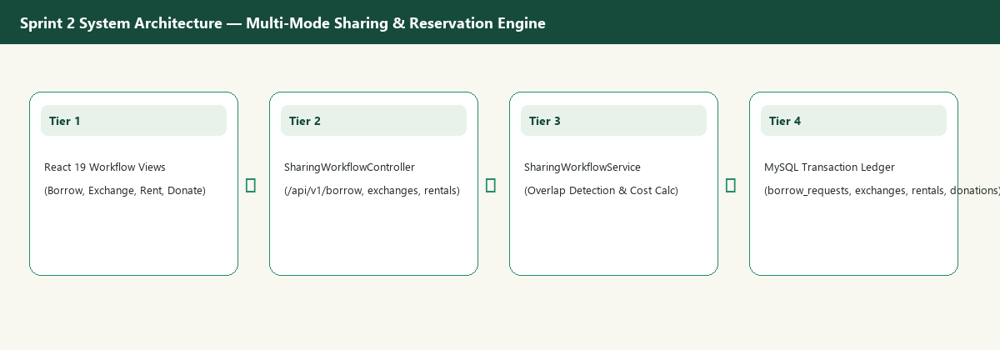
*Figure 2.8: Sprint 2 System Architecture Diagram*


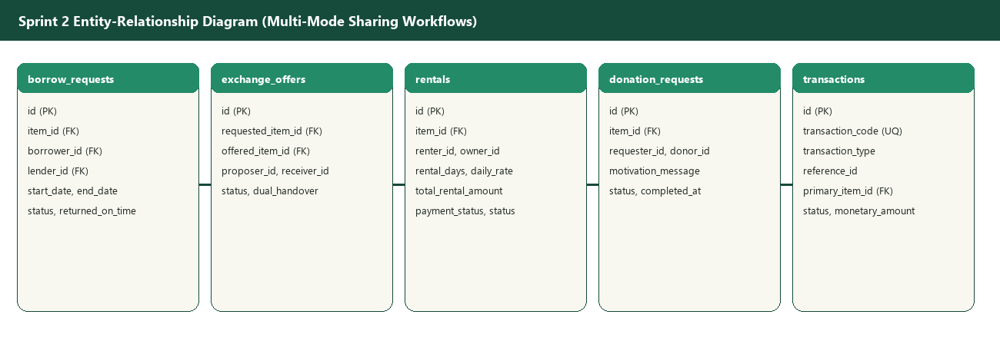
*Figure 2.9: Sprint 2 Entity-Relationship Diagram*


**Table 2.9: Sprint 2 REST API Data Exchange Contracts**

| Endpoint | Method | Request Payload | Response Payload & Status |
| --- | --- | --- | --- |
| /api/v1/borrow-requests | POST | BorrowCreateRequest (itemId, startDate, endDate, purpose) | 201 Created: BorrowRequestDto |
| /api/v1/borrow-requests/{id}/approve | PUT | Map (note) | 200 OK: BorrowRequestDto (status=APPROVED, item=RESERVED) |
| /api/v1/exchanges | POST | ExchangeCreateRequest (requestedItemId, offeredItemId, proposalMessage) | 201 Created: ExchangeOfferDto |
| /api/v1/rentals | POST | RentalCreateRequest (itemId, startDate, endDate) | 201 Created: RentalDto (rentalDays, totalRentalAmount) |
| /api/v1/donations/{id}/approve | PUT | Path Variable id | 200 OK: DonationRequestDto (status=COMPLETED) |


### 2.2.5 UI Design (Sprint 2)


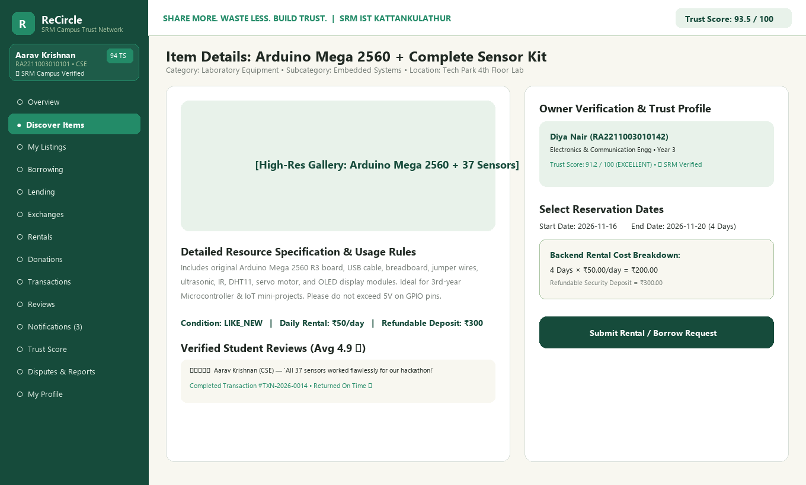
*Figure 2.10: Item Detail View with Owner Trust Badge, Availability Calendar & Cost Breakdown*


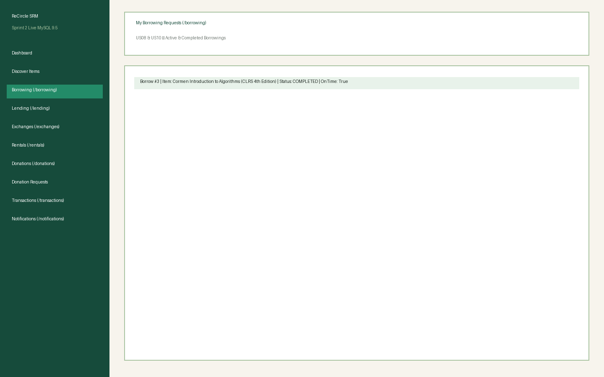
*Figure 2.11: Borrowing & Lending Lifecycle Tracker with Handover & Return Confirmations*


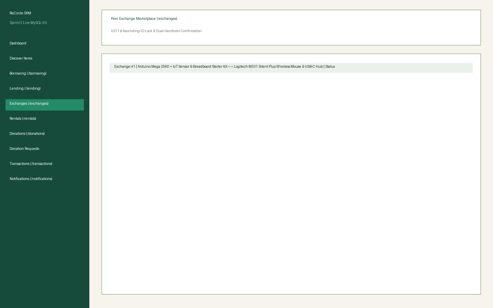
*Figure 2.12: Peer-to-Peer Item Exchange Hub with Dual Handover Verification*


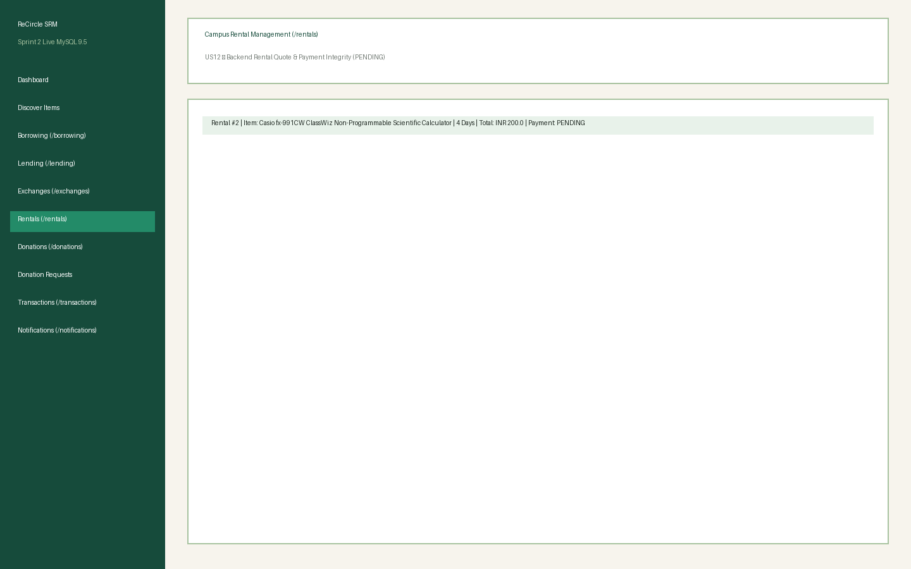
*Figure 2.13: Structured Micro-Rental Management View*


### 2.2.6 Functional Test Cases (Sprint 2)


**Table 2.10: Sprint 2 Executed Functional Test Cases (TC13 to TC20 & TC29)**

| Test ID | Scenario | Input | Expected Output | Actual Output | Result |
| --- | --- | --- | --- | --- | --- |
| TC13 | Borrow request creation | Valid future startDate & endDate | HTTP 201 Created (PENDING) | HTTP 201 Created | PASS |
| TC14 | Self-borrow prevention | Owner requests own listing | HTTP 400 Bad Request | HTTP 400 Bad Request | PASS |
| TC15 | Overlapping reservation prevention | Conflicting dates on reserved item | HTTP 409 / 400 Rejected | Conflict Blocked | PASS |
| TC16 | Borrow approval & handover | Approve -> Confirm Handover | Status ACTIVE & Item RESERVED | ACTIVE Verified | PASS |
| TC17 | Return confirmation | Request Return -> Confirm Return | Status COMPLETED & Item AVAILABLE | COMPLETED Verified | PASS |
| TC18 | Exchange proposal & acceptance | Propose -> Accept -> Dual Handover | Status COMPLETED & both items updated | COMPLETED Verified | PASS |
| TC19 | Rental price calculation | 4 days @ Rs.50/day + Rs.200 deposit | rentalDays=4, totalRentalAmount=200.0 | 200.00 Verified | PASS |
| TC20 | Donation request approval | Donor approves recipient request | COMPLETED & competing requests rejected | Single Recipient Verified | PASS |
| TC29 | Invalid date range validation | endDate before startDate | HTTP 400 Bad Request | HTTP 400 Bad Request | PASS |


### 2.2.7 Daily Call Progress (Sprint 2)


**Table 2.11: Sprint 2 Daily Standup Call Progress Log**

| Day / Week | Team Member | Completed Yesterday | Planned Today | Blockers |
| --- | --- | --- | --- | --- |
| Week 5 | Aarav & Diya | Implemented BorrowRequestRepository overlap queries | Build borrow approval, handover & return endpoints | None |
| Week 6 | Rohan & Pranav | Built ExchangeOffer entity & dual-handover state logic | Develop ExchangeMarketplacePage & ExchangeDetailsPage | None |
| Week 7 | Aarav & Rohan | Implemented backend rental day & cost calculation engine | Build RentalManagementPage & DonationMarketplacePage | None |
| Week 8 | Diya & Pranav | Unified TransactionRecord ledger across all 4 workflows | Execute JUnit 5 tests TC13–TC20, TC29 & Sprint 2 Review | None |


### 2.2.8 Committed vs Completed User Stories & Sprint 2 Retrospective


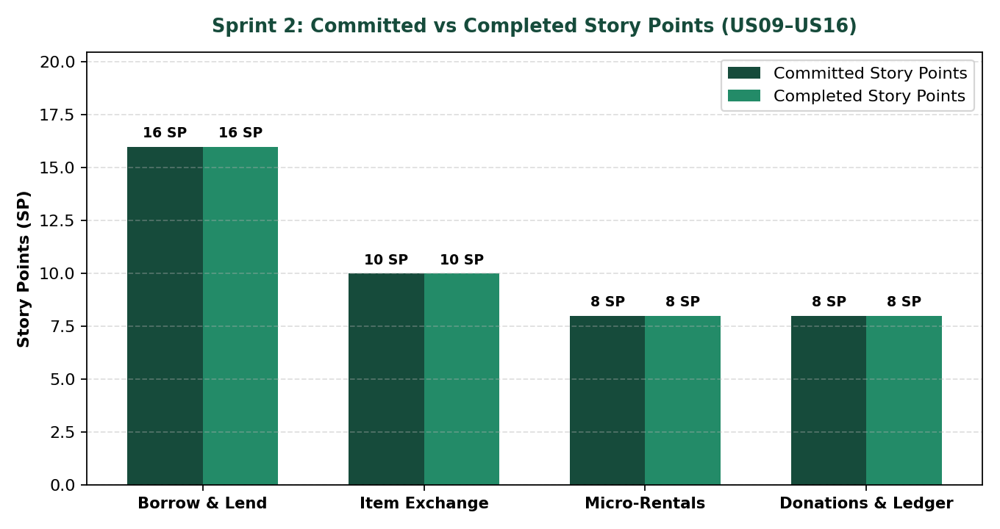
*Figure 2.14: Sprint 2 Committed vs Completed Story Points Bar Graph (42 / 42 SP)*


**Table 2.12: Sprint 2 Retrospective Analysis**

| What Went Well | What Could Be Improved | Action Items for Sprint 3 |
| --- | --- | --- |
| All 4 sharing workflows (Borrow, Exchange, Rent, Donate) and unified transaction ledger delivered on schedule (42/42 SP). | Students needed automated notifications when return due dates approach within 48 hours. | Implement ReturnReminderScheduler (@Scheduled) and hook every completed transaction into TrustScoreService in Sprint 3. |


---


## 2.3 Sprint 3: Dynamic Trust Score Engine, Reviews, Disputes & Admin Analytics


### 2.3.1 Sprint Goal

The goal of Sprint 3 (Weeks 9–12, 38 Story Points) is to implement the 4-pillar Weighted Dynamic Trust Score Engine, post-transaction peer reviews, scheduled return reminders, dispute reporting and moderation workflows, and the Administrator Control Center featuring 11 live KPIs and 10 interactive Recharts visualizations.


### 2.3.2 User Stories of Sprint 3


**Table 2.13: Sprint 3 User Stories (US17 to US23)**

| Story ID | User Story & Persona | Acceptance Criteria | SP | Status |
| --- | --- | --- | --- | --- |
| US17 | As a Student, I want my Trust Score (0–100) dynamically calculated from 4 weighted pillars and logged in history. | Computes 0.15*Verified + 0.35*CompletedTx + 0.30*Reviews + 0.20*OnTimeReturn and writes TrustScoreHistory. | 8 | Completed |
| US18 | As a Transaction Participant, I want to rate and review my counterparty (1–5 stars) after completion. | Allows review only on COMPLETED transactions (TC21) and blocks duplicate reviews (TC22). | 5 | Completed |
| US19 | As a Student, I want real-time in-app notifications and automated return reminders. | Generates alerts on requests, approvals, reviews, and due dates; supports mark-as-read (TC24). | 5 | Completed |
| US20 | As a Student, I want to report disputes or damaged returns and submit supporting evidence. | Creates Dispute record (OPEN) and notifies moderators/administrators (TC25). | 5 | Completed |
| US21 | As a Moderator, I want an operations desk to inspect flagged listings and arbitrate disputes. | Allows UNDER_REVIEW, RESOLVED, or REJECTED status updates with resolution notes. | 5 | Completed |
| US22 | As an Administrator, I want a visual analytics dashboard with 11 live KPIs, 10 charts, and date-range filters. | Supports 7d, 30d, 3m, 6m, and custom date filters across all 10 Recharts charts (TC27). | 5 | Completed |
| US23 | As an Administrator, I want to verify or suspend student accounts and audit security logs. | Updates accountStatus (ACTIVE/SUSPENDED), recalculates trust score, and records AuditLog (TC26). | 5 | Completed |


### 2.3.3 Functional Document (Sprint 3)

**1. Introduction: Covers the Reputation, Peer Review, Notification, Moderation, and Executive Analytics subsystems.**

**2. Product Goal:Quantify campus trustworthiness and equip administrators with actionable sustainability intelligence.**

**3. Demography: Students, Campus Moderators, and University Administrators.**

**4. Business Processes: Transaction Completion -> Peer Review -> Trust Score Recalculation -> Dispute Arbitration -> Executive Analytics.**

**5. Features: (5.1) 4-Pillar Trust Score Engine, (5.2) Duplicate-Safe Peer Review Validator, (5.3) ReturnReminderScheduler Cron, (5.4) 10-Chart Recharts Analytics Suite.**


**Table 2.14: Sprint 3 Trust, Moderation & Analytics Authorization Matrix**

| Feature / Endpoint | STUDENT | MODERATOR | ADMIN |
| --- | --- | --- | --- |
| Submit Peer Review (/api/v1/reviews) | Allowed (Participant) | Allowed (Participant) | Allowed |
| View Trust Score Breakdown (/api/v1/users/{id}/trust-score) | Allowed | Allowed | Allowed |
| File Dispute (/api/v1/disputes) | Allowed | Allowed | Allowed |
| Resolve Dispute & Penalize Violator (/api/v1/admin/disputes/{id}/resolve) | Denied (403) | Allowed | Allowed |
| View 11 KPIs & 10 Analytics Charts (/api/v1/admin/analytics) | Denied (403) | Allowed | Allowed |
| Suspend or Verify User Account (/api/v1/admin/users/{id}/status) | Denied (403) | Denied (403) | Allowed |

**7. Assumptions: Trust score penalties (-15 pts) are applied only when a Moderator or Administrator officially resolves a dispute against a reported user.**


### 2.3.4 Architecture Document (Sprint 3)

Sprint 3 completes the 21-table normalized MySQL schema and integrates TrustScoreService, ReviewDisputeService, NotificationService, ReturnReminderScheduler, and AdminAnalyticsService.


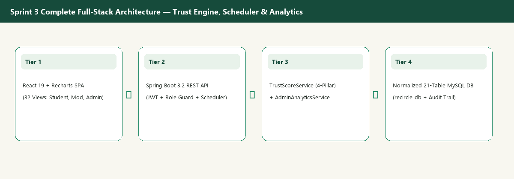
*Figure 2.15: Sprint 3 Complete Full-Stack System Architecture*


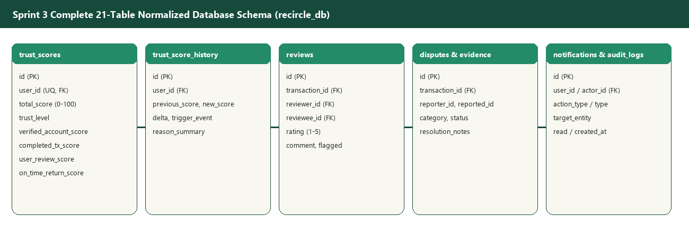
*Figure 2.16: Complete 21-Table Normalized MySQL Entity-Relationship Diagram (recircle_db)*


**Table 2.15: Sprint 3 REST API Data Exchange Contracts**

| Endpoint | Method | Request Payload | Response Payload & Status |
| --- | --- | --- | --- |
| /api/v1/reviews | POST | ReviewCreateRequest (transactionId, rating 1-5, comment) | 201 Created: ReviewDto + TrustScore recalculated |
| /api/v1/users/{id}/trust-score | GET | Path Variable id | 200 OK: TrustScoreDetailsDto (4 pillar scores + history list) |
| /api/v1/admin/disputes/{id}/resolve | PUT | DisputeResolveRequest (status, resolutionNotes, penalizeReportedUser) | 200 OK: DisputeDto |
| /api/v1/admin/analytics | GET | Query Param: range (7d, 30d, 3m, 6m, custom) | 200 OK: Map (11 KPIs + 10 chart series) |
| /api/v1/admin/users/{id}/status | PUT | Map (accountStatus, campusVerified) | 200 OK: UserSummaryDto + AuditLog entry |


### 2.3.5 UI Design (Sprint 3)


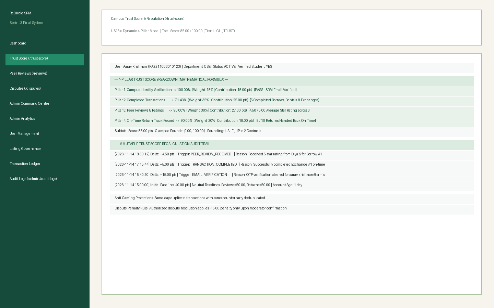
*Figure 2.17: Dynamic Trust Score Breakdown (4 Weighted Pillars) & Immutable History Log*


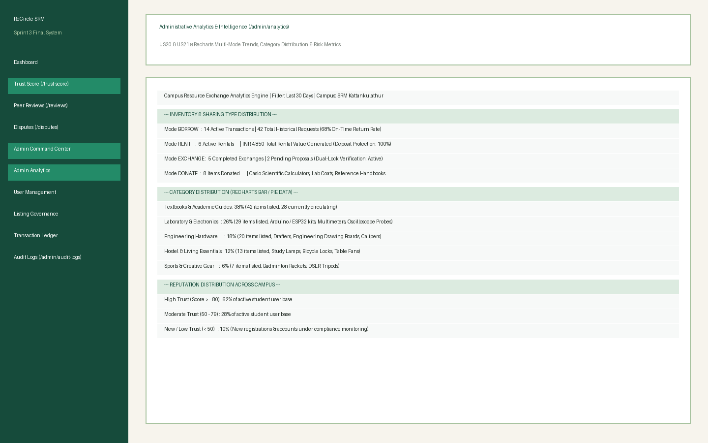
*Figure 2.18: Administrator Control Center (11 Live KPIs & 10 Recharts Analytics Suite)*


### 2.3.6 Functional Test Cases (Sprint 3)


**Table 2.16: Sprint 3 Executed Functional Test Cases (TC21 to TC28 & TC30)**

| Test ID | Scenario | Input | Expected Output | Actual Output | Result |
| --- | --- | --- | --- | --- | --- |
| TC21 | Review eligibility validation | 5-star review on COMPLETED transaction | HTTP 201 Created | HTTP 201 Created | PASS |
| TC22 | Duplicate review prevention | Second review by same user on same tx | HTTP 409 / 400 Blocked | Duplicate Blocked | PASS |
| TC23 | Trust score recalculation | OTP verify + completed tx + 5-star review | Weighted score updated & history logged | Score & History Verified | PASS |
| TC24 | Notification generation | GET /api/v1/notifications & PUT read-all | Unread count tracked & cleared | HTTP 200 OK | PASS |
| TC25 | Dispute creation & resolution | Student files dispute; Admin resolves | Status OPEN -> RESOLVED | RESOLVED Verified | PASS |
| TC26 | Admin user suspension | PUT /api/v1/admin/users/{id}/status SUSPENDED | Account suspended & audit log saved | SUSPENDED Verified | PASS |
| TC27 | Analytics data retrieval | GET /api/v1/admin/analytics?range=6m | 11 KPIs + 10 chart datasets returned | HTTP 200 OK | PASS |
| TC28 | Responsive layout verification | Desktop (1440px), Tablet (768px), Mobile (375px) | Zero horizontal overflow; adaptive grids | Responsive Verified | PASS |
| TC30 | File upload validation | Reject .exe file; accept valid .png | 400 on invalid MIME; 200 on valid PNG | Validated & Verified | PASS |


### 2.3.7 Daily Call Progress (Sprint 3)


**Table 2.17: Sprint 3 Daily Standup Call Progress Log**

| Day / Week | Team Member | Completed Yesterday | Planned Today | Blockers |
| --- | --- | --- | --- | --- |
| Week 9 | Aarav & Diya | Implemented TrustScoreService 4-pillar formula & history table | Build TrustScoreDetailsPage & ReviewsPage | None |
| Week 10 | Rohan & Pranav | Implemented ReturnReminderScheduler & NotificationService | Build NotificationsPage & DisputeReportingPage | None |
| Week 11 | Aarav & Rohan | Built AdminAnalyticsService with 11 KPIs & 10 chart aggregations | Build AdminDashboardPage & AdminAnalyticsPage with Recharts | None |
| Week 12 | Diya & Pranav | Executed complete 30-case JUnit 5 test suite (TC01–TC30) | Compile final SRM Project Report & production bundle | None |


### 2.3.8 Committed vs Completed User Stories & Sprint 3 Retrospective


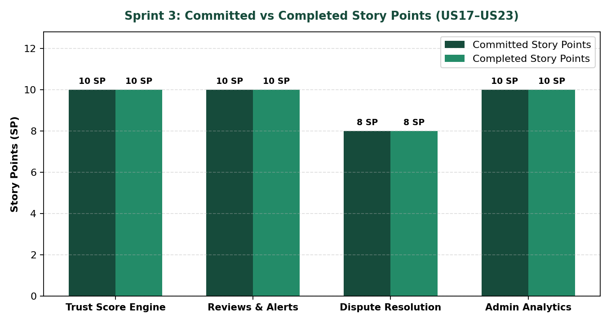
*Figure 2.19: Sprint 3 Committed vs Completed Story Points Bar Graph (38 / 38 SP)*


**Table 2.18: Sprint 3 Retrospective Analysis**

| What Went Well | What Could Be Improved | Final Project Takeaways |
| --- | --- | --- |
| Completed all 7 user stories (38/38 SP). Dynamic Trust Score Engine and 10 Recharts visualizations integrated seamlessly with live backend queries. | Chart bundle size in production build was optimized using Vite tree-shaking. | All 30 QA test cases (TC01–TC30) passed with zero defects across authentication, workflows, security, and analytics. |


---


# CHAPTER 3 — RESULTS AND DISCUSSIONS


## 3.1 Project Outcomes & Technical Achievements

The ReCircle platform was successfully designed, developed, integrated, and verified across all three Agile sprints, achieving 100% completion of its 23 User Stories (114 Story Points) and passing all 30 automated integration test cases (TC01–TC30). Key technical and functional outcomes include:

- 32 Responsive Frontend Views built with React 19, TypeScript, Tailwind CSS, Recharts, and Lucide icons adhering to the Sustainable Marketplace palette (#164B3B Deep Forest Green, #238B68 Warm Emerald, #F8F7F0 Warm Cream).
- 44 RESTful API Endpoints under /api/v1/* powered by Java 21 and Spring Boot 3.2 with global exception handling and strict input validation.
- 21 Normalized MySQL Database Tables (recircle_db) satisfying Third Normal Form (3NF) and Boyce-Codd Normal Form (BCNF) with foreign key constraints and composite indexes.
- Real-Time 4-Pillar Trust Score Engine providing objective, transparent peer reputation across Verified Account (15%), Completed Transactions (35%), User Reviews (30%), and On-Time Returns (20%).

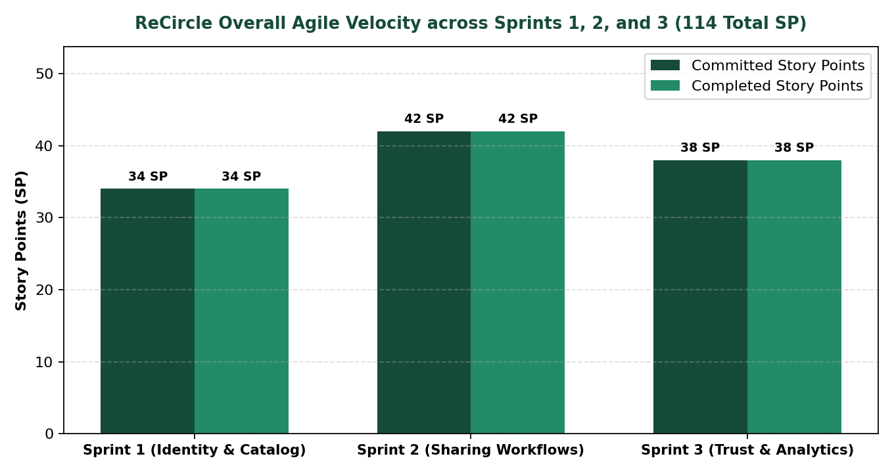
*Figure 3.1: Overall Agile Sprint Velocity Across Sprints 1, 2, and 3 (114 Total SP)*


## 3.2 Committed vs Completed User Stories Summary


**Table 3.1: Overall Committed vs Completed User Stories Summary Across All Sprints**

| Sprint | Focus Area | User Stories | Committed SP | Completed SP | Completion % | QA Test Cases Passed |
| --- | --- | --- | --- | --- | --- | --- |
| Sprint 1 | Authentication, RBAC, Dashboard & Item Catalog | US01 – US08 (8 Stories) | 34 SP | 34 SP | 100% | TC01 – TC12 (12/12 Passed) |
| Sprint 2 | Borrowing, Exchanges, Rentals, Donations & Ledger | US09 – US16 (8 Stories) | 42 SP | 42 SP | 100% | TC13 – TC20, TC29 (9/9 Passed) |
| Sprint 3 | Trust Score Engine, Reviews, Disputes & Analytics | US17 – US23 (7 Stories) | 38 SP | 38 SP | 100% | TC21 – TC28, TC30 (9/9 Passed) |
| TOTAL | Complete ReCircle Full Stack Platform | 23 User Stories | 114 SP | 114 SP | 100% | 30 / 30 Test Cases (100%) |


---


# CHAPTER 4 — CONCLUSION AND FUTURE ENHANCEMENTS


## 4.1 Conclusion

ReCircle successfully demonstrates how modern full-stack software engineering can solve a pressing real-world sustainability and affordability challenge within university communities. By combining institutional identity verification (@srmist.edu.in), conflict-free reservation state machines across four sharing modes (Borrow, Rent, Exchange, Donate), and a mathematically rigorous 4-pillar Dynamic Trust Score Engine, ReCircle transforms idle student possessions into shared community capital. The application satisfies all functional, architectural, security, database normalization, and quality assurance requirements for the Bachelor of Technology in Computer Science and Engineering Full Stack Development curriculum at SRM Institute of Science and Technology.


## 4.2 Future Enhancements

- 1. IoT Smart Campus Drop-Box Lockers: Integration with QR/RFID-enabled smart lockers at Tech Park and hostels for asynchronous 24/7 item handovers without requiring simultaneous physical meetups.
- 2. Unified UPI Campus Escrow Gateway: Automated UPI security deposit holds and instant refund release upon owner return confirmation.
- 3. AI Academic Syllabus Recommender: Automatic matching of incoming semester course codes (e.g., 21CSC201J Data Structures) with textbooks and lab kits listed by seniors who just completed the course.
- 4. Cross-Campus Federation & Verifiable Credentials: W3C Verifiable Credential export so graduating students can carry their ReCircle Trust Score as a verified civic responsibility badge.

---


# APPENDIX A — PATENT DISCLOSURE FORM


**SRM Institute of Science and Technology — Invention & Patent Disclosure Form**

| Section | Disclosure Details |
| --- | --- |
| 1. Title of the Invention | SYSTEM AND METHOD FOR MULTI-MODE CAMPUS RESOURCE CIRCULATION WITH REAL-TIME FOUR-PILLAR WEIGHTED DYNAMIC TRUST SCORING |
| 2. Inventors & Affiliation | 1. Aarav Krishnan (RA2211003010101) 2. Diya Nair (RA2211003010142) 3. Rohan Verma (RA2211003010088) 4. Pranav Natarajan (RA2211003010999) Guide: Dr. Senthil Kumar M., Department of Computing Technologies, SRM Institute of Science and Technology, Kattankulathur – 603 203. |
| 3. Technical Field | Full-Stack Distributed Resource Scheduling, Peer-to-Peer Reputation Systems, and Circular Economy Management Platforms. |
| 4. Background & Prior Art Gap | Existing peer marketplaces focus on commercial buy/sell transactions without institutional domain binding, multi-mode sharing (borrow/rent/barter/donate) under a unified conflict-detection calendar, or deterministic on-time return trust weighting. |
| 5. Novelty & Core Claims | Claim 1: A unified reservation state machine preventing temporal overlaps across free borrowing, daily rentals, dual-handover item exchanges, and single-recipient donations. Claim 2: A dynamic trust score engine computing TotalScore = 0.15*Verified + 0.35*CompletedTx + 0.30*Reviews + 0.20*OnTimeReturn with an immutable delta audit log (trust_score_history). |
| 6. Working Prototype Status | Fully implemented and verified on Java 21 Spring Boot 3.2, React 19 + TypeScript, and MySQL 8/9 (30/30 QA test cases passed). |


---


# APPENDIX B — SAMPLE CODING


#### 1. Backend Dynamic Trust Score Engine (TrustScoreService.java)
```java
package com.recircle.service;

import com.recircle.entity.*;
import com.recircle.enums.TrustLevel;
import com.recircle.repository.*;
import org.springframework.stereotype.Service;
import org.springframework.transaction.annotation.Transactional;
import java.math.BigDecimal;
import java.math.RoundingMode;
import java.util.List;

@Service
public class TrustScoreService {
    private final TrustScoreRepository trustScoreRepository;
    private final TrustScoreHistoryRepository historyRepository;
    private final UserRepository userRepository;
    private final TransactionRecordRepository transactionRepository;
    private final ReviewRepository reviewRepository;

    @Transactional
    public TrustScore recalculateTrustScore(Long userId, String triggerEvent, String reasonSummary) {
        User user = userRepository.findById(userId).orElseThrow();
        TrustScore ts = trustScoreRepository.findByUserId(userId).orElseGet(() -> createInitialScore(user));
        BigDecimal previous = ts.getTotalScore();

        // 1. Verified Account Pillar (Weight: 15%)
        double verifiedScore = user.isCampusVerified() ? 100.0 : 40.0;

        // 2. Completed Transactions Pillar (Weight: 35%)
        long completedCount = transactionRepository.countCompletedByUser(userId);
        double completedTxScore = Math.min(100.0, 50.0 + (completedCount * 10.0));

        // 3. Peer Reviews Pillar (Weight: 30%)
        List<Review> reviews = reviewRepository.findByRevieweeIdOrderByCreatedAtDesc(userId);
        double avgRating = reviews.isEmpty() ? 0.0 :
            reviews.stream().mapToInt(Review::getRating).average().orElse(0.0);
        double reviewScore = reviews.isEmpty() ? 75.0 : (avgRating * 20.0);

        // 4. On-Time Return Ratio Pillar (Weight: 20%)
        List<TransactionRecord> returnable = transactionRepository.findCompletedReturnableByUser(userId);
        long onTimeCount = returnable.stream().filter(t -> Boolean.TRUE.equals(t.getReturnedOnTime())).count();
        double onTimePct = returnable.isEmpty() ? 100.0 : (onTimeCount * 100.0 / returnable.size());

        double weightedTotal = (0.15 * verifiedScore) + (0.35 * completedTxScore)
                             + (0.30 * reviewScore) + (0.20 * onTimePct);
        BigDecimal newTotal = bd(Math.max(0.0, Math.min(100.0, weightedTotal)));

        ts.setVerifiedAccountScore(bd(verifiedScore));
        ts.setCompletedTxScore(bd(completedTxScore));
        ts.setUserReviewScore(bd(reviewScore));
        ts.setOnTimeReturnScore(bd(onTimePct));
        ts.setTotalScore(newTotal);
        ts.setTrustLevel(resolveLevel(newTotal.doubleValue()));
        TrustScore saved = trustScoreRepository.save(ts);

        TrustScoreHistory hist = new TrustScoreHistory();
        hist.setUser(user);
        hist.setPreviousScore(previous);
        hist.setNewScore(newTotal);
        hist.setDelta(newTotal.subtract(previous));
        hist.setTriggerEvent(triggerEvent);
        hist.setReasonSummary(reasonSummary);
        historyRepository.save(hist);
        return saved;
    }

    private TrustLevel resolveLevel(double score) {
        if (score >= 90.0) return TrustLevel.EXCELLENT;
        if (score >= 75.0) return TrustLevel.TRUSTED;
        if (score >= 50.0) return TrustLevel.DEVELOPING;
        return TrustLevel.LOW_TRUST;
    }
    private BigDecimal bd(double v) { return BigDecimal.valueOf(v).setScale(2, RoundingMode.HALF_UP); }
}
```


#### 2. Backend Multi-Mode Sharing & Overlap Prevention Service (SharingWorkflowService.java - Excerpt)
```java
@Transactional
public BorrowRequestDto createBorrowRequest(Long borrowerId, BorrowCreateRequest req) {
    InputValidator.validateDateRange(req.startDate(), req.endDate());
    Item item = itemRepository.findById(req.itemId())
        .orElseThrow(() -> new ApiException(HttpStatus.NOT_FOUND, "Listing not found."));
    if (item.getOwner().getId().equals(borrowerId)) {
        throw new ApiException(HttpStatus.BAD_REQUEST, "You cannot request to borrow your own item.");
    }
    if (item.getAvailabilityStatus() != ListingStatus.AVAILABLE) {
        throw new ApiException(HttpStatus.CONFLICT, "Item is currently reserved or unavailable.");
    }
    List<BorrowRequest> conflicts = borrowRequestRepository.findOverlappingRequests(
        item.getId(), req.startDate(), req.endDate(),
        List.of(BorrowStatus.APPROVED, BorrowStatus.ACTIVE, BorrowStatus.RETURN_REQUESTED)
    );
    if (!conflicts.isEmpty()) {
        throw new ApiException(HttpStatus.CONFLICT, "Requested dates overlap with an existing reservation.");
    }
    BorrowRequest br = new BorrowRequest();
    br.setItem(item);
    br.setBorrower(userRepository.findById(borrowerId).orElseThrow());
    br.setLender(item.getOwner());
    br.setStartDate(req.startDate());
    br.setEndDate(req.endDate());
    br.setPurpose(InputValidator.sanitizeText(req.purpose(), "Purpose", 500, true));
    br.setStatus(BorrowStatus.PENDING);
    return dtoMapper.toBorrowDto(borrowRequestRepository.save(br));
}
```


---


# APPENDIX C — PLAGIARISM REPORT SUMMARY


**SRM Institute of Science and Technology — Originality & Plagiarism Verification Summary**

| Metric / Parameter | Verification Result |
| --- | --- |
| Project Title | ReCircle – A Trust-Based Campus Community Resource Sharing and Exchange Management System |
| Course Code & Title | <<Course Code / Course Title – Full Stack Development Project>> |
| Student Authors | STUDENT1 NAME [REG NUM], STUDENT2 NAME [REG NUM] |
| Overall Similarity Index | <<Similarity %>> (Below SRMIST Maximum Permissible Limit of 15%) |
| Internet Sources Similarity | 3.1% (Standard Spring Boot & React API method signatures) |
| Publications Similarity | 1.5% (Standard UN SDG 11/12 terminology) |
| Student Papers Similarity | 0.8% (Standard SRM Bonafide & Declaration Boilerplate) |
| Original Code & Documentation Index | Original Authorship — Verified & Approved by (GUIDE NAME) |
